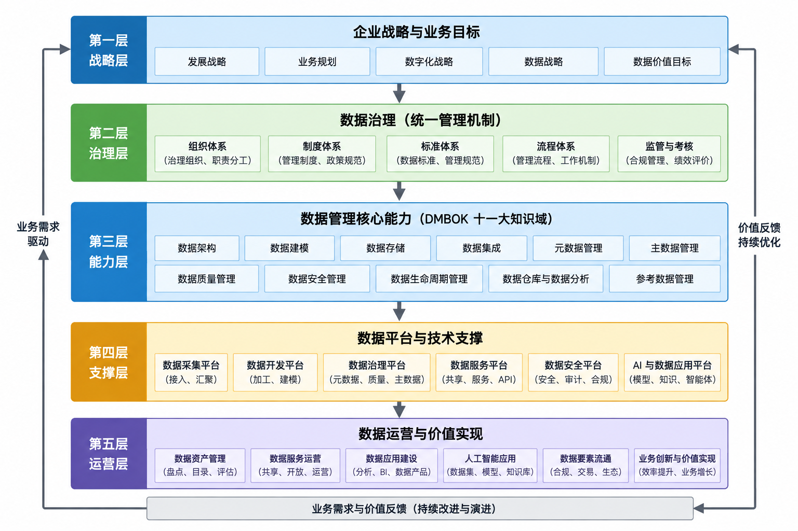
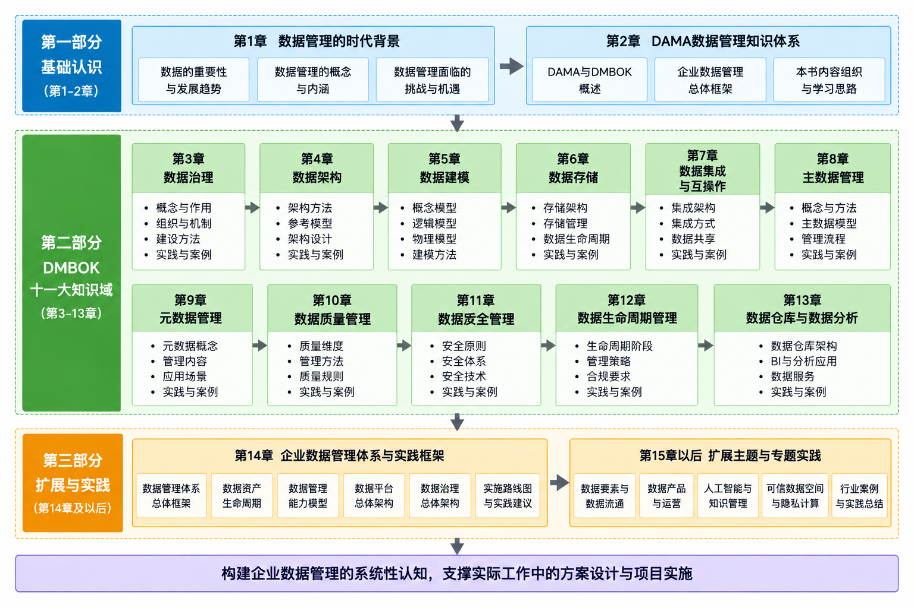

## 第2章 DAMA知识体系概述

前面我们回顾了数字经济的发展背景、数据成为生产要素的历史过程，以及企业为什么需要数据管理。通过这些内容，我们已经回答了一个问题：为什么企业必须管理数据。

然而，一个新的问题随之产生。

如果数据管理如此重要，那么企业究竟应该如何管理数据？

现实中的企业数据管理远比想象中复杂。一个大型企业可能拥有数百个业务系统、数千张业务表、数万个数据对象以及数十亿条业务记录。与此同时，不同业务部门拥有各自的数据标准、业务规则和管理流程，数据不断产生、流转、共享和更新。如果缺乏统一的方法论，企业的数据管理工作往往会陷入"头痛医头、脚痛医脚"的局面：今天解决数据质量问题，明天建设元数据平台，后天开展主数据建设，每一个项目都具有一定价值，却始终无法形成完整的数据管理体系。

因此，企业需要的不仅是若干项数据管理技术，更需要一套能够统筹规划数据管理能力的方法论。

在国际数据管理领域，**DAMA（Data Management Association，国际数据管理协会）**及其发布的 DMBOK（Data Management Body of Knowledge，数据管理知识体系），正是在这样的背景下逐渐发展成为全球应用最广泛的数据管理方法体系之一。它并不是一种具体的软件产品，也不是一种开发框架，而是一套覆盖组织、制度、流程、技术和运营的数据管理方法论。

对于很多初学者而言，第一次接触 DMBOK 时，往往会把它理解为一本介绍十一大知识域的教材。然而，真正理解 DMBOK 的关键，并不在于记住每一个知识域的定义，而在于理解这些知识域为什么存在、它们之间如何协同，以及如何共同支撑企业的数据资产管理。

在后面的内容我并不准备逐条解释十一大知识域，而是希望帮助大家能建立一张完整的数据管理"地图"。

当大家读完这部分的内容以后，应当能够较清晰的了解以下几个问题：

十一大知识域分别解决什么问题？

十一大知识域之间是什么关系？

企业如何利用这些能力建立完整的数据管理体系？

不谋全局者，不足谋一域。认识一座陌生的城市，最好先有一张地图；进入一个新的知识领域，同样需要先看清它的整体结构。否则，掌握得再多，也很容易只是一些彼此割裂的知识碎片。数据管理涉及治理、架构、质量、标准、主数据、安全等众多领域，因此在逐一深入之前，有必要先建立一张完整的“数据管理地图”，弄清楚这些领域分别解决什么问题、彼此之间又是什么关系。

### 2.1 什么是DAMA

在学习数据管理的过程中，几乎所有人都会接触到一个名称——DAMA。

很多培训课程将 DAMA 简单介绍为"国际数据管理协会"，随后便开始讲解 DMBOK 的十一大知识域。然而，这种介绍方式容易让大家产生一种误解：DAMA 只是一个发布教材的组织。

事实上，DAMA 的意义远不止于此。

数据管理为什么需要一套国际方法论

回顾企业信息化的发展历程可以发现，数据库技术、网络技术、软件工程等领域，很早就形成了相对成熟的理论体系和工程规范。

例如，软件开发领域形成了瀑布模型、敏捷开发、DevOps 等成熟方法；项目管理领域形成了 PMBOK；IT 服务管理领域形成了 ITIL；信息安全领域形成了 ISO/IEC 27001、NIST 等标准体系。

这些理论体系虽然关注点不同，但都有一个共同特点：它们并不是告诉企业应该购买什么产品，而是告诉企业应该如何建立能力。

数据管理的发展却经历了不同的过程。

在很长一段时间内，企业更多关注数据库管理，而不是数据管理。数据库管理员负责数据库安装、备份恢复、性能优化；开发人员负责数据表设计；业务部门负责业务数据维护。每个人都在管理数据的一部分，却没有任何一个组织负责企业整体的数据管理。

随着企业信息系统不断增加，这种分散管理模式开始暴露越来越多的问题。

不同部门建立不同的数据标准，同一个客户拥有多个编码，同一个指标存在多个计算口径，不同系统之间的数据无法共享，数据质量持续下降。企业投入大量资金建设信息系统，却始终无法形成统一的数据资产。

问题逐渐变得清晰。

企业真正缺少的，不是数据库技术，而是数据管理体系。

正是在这样的背景下，国际数据管理领域开始不断总结各行业实践经验，希望建立一套能够跨行业、跨技术平台、跨组织推广的数据管理方法论。DAMA 正是在这一过程中逐步发展起来，并成为国际数据管理领域最具影响力的专业组织之一。

因此，可以认为，DAMA 的价值并不在于定义了若干个概念，而在于推动数据管理从一项技术工作逐渐发展成为一门独立的管理学科。

DAMA 的核心使命

从组织定位来看，DAMA 致力于推动数据管理理论的发展和行业实践，其核心目标可以概括为三个方面。

第一，建立统一的数据管理知识体系。

不同企业、不同行业的数据管理实践各不相同，但底层规律具有高度一致性。通过不断总结实践经验，DAMA 将分散的数据管理能力归纳为统一的方法体系，使企业能够采用共同的语言讨论数据管理问题。

第二，推动数据管理专业化。

传统企业往往将数据管理视为数据库管理员或者开发人员的附属工作，而现代企业越来越需要专门的数据架构师、数据治理工程师、数据质量工程师、元数据管理员等专业岗位。DAMA 的出现，使数据管理逐渐形成完整的职业体系。

第三，促进企业数据价值实现。

需要强调的是，DAMA 的目标从来不是帮助企业建设更多的数据平台，而是帮助企业更好地利用数据创造价值。数据治理、数据架构、元数据管理、数据质量等能力，本质上都是服务于数据价值实现，而不是为了治理而治理。

我们需要时刻牢记，数据管理不是目的，数据价值实现才是目的；数据治理不是终点，而是企业数字化能力建设的重要基础。

DAMA 与 DMBOK 的关系

很多大家容易将 DAMA 与 DMBOK 混为一谈，实际上，两者并不是同一个概念。

DAMA 是国际数据管理协会，是推动数据管理理论发展和行业交流的专业组织；DMBOK 则是 DAMA 组织长期积累形成的数据管理知识体系，它总结了企业数据管理过程中最核心、最稳定、最具有普遍意义的方法论。

可以把两者理解为"组织"与"知识体系"之间的关系。

如果说 DAMA 是推动数据管理发展的平台，那么 DMBOK 就是这一平台最重要的理论成果。

后面的内容，我将结合项目实践，以 DMBOK 为理论基础，但并不会局限于 DMBOK 本身。

原因很简单。

DMBOK 更多回答的是"应该具备哪些能力"，而今天的企业更关心的是"这些能力如何落地"。

例如，在 DMBOK 第一版发布时，大数据平台尚未普及，数据中台尚未出现，可信数据空间、数据要素市场、大模型、RAG、Agent 等概念更不存在。而今天的数据管理已经进入新的发展阶段，仅仅学习传统理论已经不足以支撑企业实践。

因此，我的分享将坚持三个层次的写作原则。

第一层，以DMBOK为基础，介绍数据管理的基本理论。

第二层，结合企业数字化建设实践，介绍数据平台、数据资源体系、数据治理体系等工程方法。

第三层，结合 AI 时代的发展，分析知识库、多模态数据管理、模型治理等新方向。

也正因为如此，我不想做DMBOK的导读，而是希望形成面向企业实践的数据资产管理方法论。

### 2.2 DMBOK的发展

任何一种成熟的方法论，都不是某一天突然产生的，而是在长期工程实践中不断总结、不断完善的结果。

DMBOK 同样如此。

它既不是一本教材，也不是某一位专家个人提出的理论，而是全球数据管理实践不断积累形成的知识体系。

理解 DMBOK 的发展历程，有助于理解整个数据管理思想为什么会不断演进。

从数据库管理到数据管理

二十世纪七八十年代，企业信息化建设刚刚起步，数据管理更多意味着数据库管理。

这一时期，企业关注的重点主要集中在数据存储、事务处理、数据库性能以及备份恢复等技术问题。数据管理工作的核心对象是数据库系统，而不是企业的数据资产。

进入二十世纪九十年代以后，企业业务系统快速增加，ERP、CRM、SCM 等系统相继投入应用，企业开始积累越来越多的数据。

与此同时，一个新的问题逐渐显现。

企业拥有大量数据，却无法形成统一的数据视图。

销售部门的数据、财务部门的数据、供应链的数据彼此独立，业务指标互不一致，数据重复建设现象越来越严重。

于是，数据仓库、ETL、商业智能等技术快速发展，企业开始尝试建立统一的数据分析平台。

这一时期，人们开始认识到，真正需要管理的对象，不只是数据库，而是整个企业的数据。

数据治理思想的形成

进入二十一世纪以后，互联网技术和企业数字化建设快速发展，数据规模呈指数级增长。

企业发现，仅仅依靠技术平台已经无法解决数据问题。

大量数据质量问题来源于组织职责不清、标准不统一、业务规则缺失，而不是数据库性能不足。越来越多的企业开始建立数据治理组织，制定数据标准，明确数据责任人，推动数据质量持续改进。

数据管理开始从技术管理逐步转向管理与技术相结合的新阶段。

这一时期，DMBOK 对数据治理、数据架构、元数据管理、主数据管理、数据质量等能力进行了系统整理，使企业第一次能够站在整体视角理解数据管理，而不是孤立解决某一个技术问题。

DMBOK 为什么划分为十一大知识域

很多初学者都会提出一个问题：为什么 DMBOK 要划分为十一大知识域？

事实上，这十一大知识域并不是按照软件产品划分，也不是按照组织部门划分，而是按照企业数据管理能力进行划分。

每一个知识域都对应企业必须具备的一项核心能力。

数据治理负责建立管理机制；数据架构负责规划整体结构；数据建模负责定义数据组织方式；数据存储负责保障数据可靠运行；数据集成负责实现数据流转；数据安全负责保护数据；元数据负责建立统一语义；主数据负责维护核心业务对象；数据质量负责保证数据可信；数据仓库与商业智能负责数据分析；文档与内容管理则负责非结构化数据管理。

这些能力共同构成企业完整的数据管理体系。

因此，DMBOK 的真正价值，不在于提出了十一项技术，而在于告诉企业：数据管理是一项系统工程，任何单一能力都无法独立完成数据资产建设。

AI 时代，DMBOK 是否已经过时？

近年来，随着生成式人工智能快速发展，很多人开始提出新的疑问。

既然企业已经开始建设知识库、RAG、大模型和智能体，那么传统 DMBOK 是否已经过时？

本书的答案是否定的。

AI 改变了数据的使用方式，却没有改变数据管理的基本规律。

无论是企业知识库还是智能体系统，其底层仍然依赖高质量的数据来源、统一的数据标准、完整的元数据、可靠的数据质量以及严格的数据安全控制。如果这些基础能力缺失，大模型只能放大数据问题，而不会消除数据问题。

真正发生变化的，是数据管理的边界正在不断扩展。

传统 DMBOK 主要关注企业数据资产，而今天的数据管理对象已经逐渐扩展到知识对象、向量数据、多模态内容、模型资产以及智能体协同。数据管理正在向知识管理和智能管理演进，但其核心思想——通过系统化管理提升数据价值——始终没有改变。

因此，我希望在充分尊重 DMBOK 所建立的数据管理基础理论的基础上，结合当前数据要素市场、可信数据空间以及 AI 技术的发展，对传统知识体系进行必要扩展，使大家既能够理解经典理论，也能够掌握未来数据管理的发展方向。

在后续章节中，我们将看到，十一大知识域并不是彼此独立的"十一门课程"，而是一套相互依赖、相互支撑的数据管理能力体系。理解这种关系，比记住每一个定义更加重要，也正是本书区别于传统 DAMA 教材的重要特点。

### 2.3 十一大知识域简介

很多大家第一次翻开 DMBOK 时，最容易陷入一种误区：把十一大知识域理解为十一门彼此独立的课程。

于是，学习过程往往变成了"今天学习数据治理，明天学习数据架构，后天学习元数据"，每一个知识域都能够理解，但始终不知道它们为什么会同时存在，更不知道它们在企业项目中如何协同工作。

事实上，十一大知识域并不是十一项孤立的技术，而是企业数据管理体系的十一项核心能力。

如果把企业的数据管理体系比作一座现代化城市，那么数据治理相当于城市管理者，负责制定规则；数据架构相当于城市规划，负责整体布局；数据建模决定建筑物如何设计；数据存储负责基础设施建设；数据集成负责道路交通；元数据相当于城市地图；主数据则像居民户籍和法人登记；数据质量负责监督城市运行质量；数据安全保障城市安全；数据仓库与商业智能负责城市运行分析；文档与内容管理则负责管理城市中大量非结构化的信息资料。

只有这些能力共同运行，整个城市才能高效运转。

因此，在学习每一个知识域之前，更重要的是理解它们各自承担什么职责。

**数据治理（Data Governance）**

数据治理是整个数据管理体系的顶层能力，也是十一大知识域的核心。

很多企业认为，数据治理就是制定几份制度、召开几次会议，或者建设一套治理平台。这种理解过于片面。

数据治理真正解决的是"谁来管理数据、依据什么规则管理数据、如何保证这些规则能够持续执行"的问题。

它关注的是组织、制度、职责、流程、监督和持续改进，而不是具体的数据处理技术。

可以说，数据治理决定了整个数据管理体系是否能够长期稳定运行。

**数据架构（Data Architecture）**

如果说数据治理负责制定规则，那么数据架构负责设计蓝图。

企业拥有的数据来自不同业务系统，未来还会不断增加新的系统、新的数据源和新的应用场景。如果没有统一的数据架构，每增加一个系统，整个数据环境都会变得更加复杂。

数据架构关注的是企业数据整体应该如何组织，包括数据域划分、数据模型体系、数据流向、技术架构以及平台布局。

优秀的数据架构并不会解决所有问题，但能够保证未来的问题越来越容易解决。

**数据建模与设计（Data Modeling & Design）**

数据模型是现实世界在信息系统中的抽象表达。

客户、订单、设备、人员、合同、产品等现实对象，都需要通过数据模型进行统一描述。

良好的数据模型不仅能够支持系统开发，还决定了后续数据分析、数据共享以及人工智能应用的质量。

因此，数据建模既是数据库设计的重要基础，也是企业统一数据语言的重要手段。

**数据存储与操作（Data Storage & Operations）**

所有的数据最终都需要存储。

从传统关系数据库，到分布式数据库、数据湖、湖仓一体、对象存储，再到云原生数据库，数据存储技术不断发展，但其核心目标始终没有改变。

即保证数据能够安全、稳定、高效地保存，并能够持续支撑业务运行。

这一知识域更多关注数据基础设施建设，是企业数据平台的重要组成部分。

**数据安全（Data Security）**

随着数据价值不断提高，数据安全已经不仅仅是信息安全问题，而是企业经营管理的重要组成部分。

数据安全不仅包括访问控制、身份认证、加密脱敏等技术措施，也包括数据分类分级、权限管理、安全审计、隐私保护以及法律法规遵从。

尤其是在数据要素流通和人工智能时代，数据安全已经成为数据价值实现的重要前提。

没有安全，就没有共享；没有共享，就没有数据价值。

**数据集成与互操作（Data Integration & Interoperability）**

企业的数据从来不会集中产生。

ERP、CRM、MES、SCADA、IoT、互联网平台、办公系统以及第三方平台，每天都在持续产生新的数据。

数据集成负责解决这些数据如何采集、交换、同步和共享的问题。

传统 ETL、实时数据同步、消息总线、API 集成、数据虚拟化等技术，都属于这一知识域的实现方式。

现代企业的数据平台，本质上就是建立在数据集成能力之上的。

**文档与内容管理（Document & Content Management）**

这是很多初学者容易忽略的一个知识域。

过去的数据管理主要针对结构化数据，而今天企业越来越多的重要信息保存在文档、图片、视频、音频、邮件、合同、设计图纸等非结构化内容中。

尤其是在大模型时代，RAG 知识库管理的对象，大部分正是这一类内容。

因此，文档与内容管理的重要性正在不断提升，它已经不仅是传统意义上的档案管理，而逐渐成为企业知识管理的重要组成部分。

**主数据与参考数据（Master & Reference Data）**

企业内部大量业务系统都会维护客户、供应商、产品、组织机构、人员等基础信息。

如果每一个系统都维护自己的版本，就会产生大量重复和冲突的数据。

主数据管理就是建立企业唯一可信的数据源，使所有业务系统围绕统一的数据对象运行。

可以说，主数据是企业数字化协同的重要基础。

**数据仓库与商业智能（Data Warehousing & Business Intelligence）**

数据管理最终必须服务于业务。

数据仓库负责建立统一的数据分析平台，将来自不同系统的数据进行整合和组织；商业智能则利用这些数据形成报表、指标、分析模型和决策支持能力。

近年来，随着实时分析、大数据平台以及 AI 技术的发展，商业智能的实现方式不断变化，但"利用数据支撑决策"这一目标始终没有改变。

**元数据管理（Metadata Management）**

很多人认为元数据只是"数据的数据"。

这个定义没有错误，但远远不够。

从企业角度来看，元数据最大的作用，是建立统一的数据语言。

什么叫客户？

订单金额如何计算？

指标来自哪张表？

某一个字段是谁维护？

这些问题都依赖元数据回答。

没有元数据，企业的数据平台只是数据堆积；有了元数据，数据才能真正形成知识体系。

因此，元数据可以理解为整个企业数据世界的"地图"。

**数据质量（Data Quality）**

数据质量管理关注的是数据是否真实、准确、完整、一致、及时和可用。

很多企业建设了先进的数据平台，却始终无法获得可靠的数据分析结果，其根本原因并不是平台能力不足，而是数据质量没有得到持续保障。

数据质量不是项目验收时的一次检查，而是一项贯穿整个数据生命周期的持续运营能力。

现代企业越来越强调"可信数据"，其本质就是建立持续的数据质量管理机制。

十一大知识域共同构成完整的数据管理体系

以上十一项能力覆盖了企业数据管理的主要方面。

需要强调的是，它们之间没有高低之分，也不存在某一个知识域能够替代另一个知识域。

不同企业的发展阶段不同，建设重点也会有所不同。例如，一家刚刚开始数字化建设的企业，可能首先关注数据架构和数据集成；一家已经完成数据平台建设的企业，则更加关注数据治理、数据质量和数据运营；进入 AI 建设阶段以后，文档管理、元数据管理和知识治理的重要性又会进一步提升。

因此，学习 DMBOK 的真正目标，并不是记住十一大知识域，而是理解企业在不同阶段需要具备哪些数据管理能力，以及这些能力如何共同支撑企业的数据资产建设。

### 2.4 十一知识域之间的关系

对于第一次学习 DMBOK 的大家来说，最大的困难通常不是理解每一个知识域，而是不理解它们之间的关系。

为什么数据治理排在第一？

为什么元数据管理放在后面？

为什么数据安全不是最后建设？

为什么数据仓库不是整个体系的核心？

这些问题如果不能回答，就意味着还没有真正理解 DMBOK。

事实上，DMBOK 官方目录是一种知识分类，而不是企业项目实施顺序。

这一点，是很多教材没有解释清楚，也是本书希望重点说明的问题。

官方顺序，不等于工程顺序

DMBOK 将十一大知识域按照知识体系进行组织，这是一本知识手册应有的结构。

但是，当企业真正启动一个数据平台项目时，并不会按照书中的章节依次实施。

没有一家企业会按照这样的顺序建设：

数据治理 → 数据架构 → 数据建模 → 数据存储 → 数据安全……

现实项目往往是多个能力同步推进，相互依赖。

因此，站在架构师角度，我们更应该关注的是能力之间的逻辑关系，而不是章节排列顺序。

企业数据管理能力之间的逻辑链

从企业建设实践来看，十一项能力实际上形成了一条完整的数据管理链路。

首先，企业需要通过数据治理明确管理目标、组织职责和制度规范。

在治理规则建立以后，需要利用数据架构规划整个企业的数据蓝图，明确数据域划分、总体结构以及未来的发展方向。

在总体架构基础上，进一步开展数据建模，统一描述业务对象及其关系。

随后，通过数据存储建设基础设施，通过数据集成实现不同系统之间的数据流转。

当数据开始跨系统共享时，就必须依靠元数据管理建立统一的数据语义，利用主数据管理维护企业核心业务对象，依靠数据质量管理持续保证数据可信，同时通过数据安全管理确保数据合法、合规、安全地使用。

最终，经过治理的数据进入数据仓库、数据服务平台以及商业智能系统，支撑经营分析、数据产品、人工智能应用以及业务创新，实现数据价值持续释放。

从这个角度来看，十一大知识域并不是十一块孤立的拼图，而是一条完整的数据价值链。

一个知识域解决不了企业的数据问题

现实项目中，经常能够看到一种现象。

企业希望通过建设一套元数据平台解决数据治理问题；希望通过采购主数据产品解决数据标准问题；希望建设数据中台以后所有数据问题都能够自动消失。

这种想法本质上都是把数据管理理解为单一技术能力。

实际上，任何一个知识域都只能解决整个体系中的一部分问题。

例如，元数据能够回答"数据是什么"，却不能决定"数据应该由谁负责"；数据质量能够发现错误，却不能制定企业的数据标准；数据安全能够保护数据，却不能提高数据价值。

企业真正需要建设的，不是某一个平台，而是一整套数据管理能力。

这里我们尝试从工程视角理解十一大知识域。

为了帮助大家建立整体认知，我尝试保持 DMBOK 官方章节顺序，以方便学习、查阅和认证考试，但在理解方法上采用企业工程视角。

后续每一个知识域，都将围绕三个问题展开。

第一，这项能力为什么存在，它解决什么问题。

第二，它与其他知识域是什么关系，在企业项目中如何协同。

第三，它在数字经济、数据要素以及 AI 时代如何继续演进。

通过这种方式，大家看到的不再是十一个独立章节，而是一套相互联系、层层递进的数据管理体系。

在接下来的 2.5 企业数据管理总体框架 中，我们将在这一逻辑基础上，进一步构建一张贯穿全书的数据管理总体架构图，把十一大知识域放到同一张"地图"中进行理解。从第三章开始，每学习一个知识域，大家都能够清楚地知道它在整个企业数据管理体系中的位置，以及它如何与其他能力共同支撑数据资产的形成与价值实现。

### 2.5 企业数据管理总体框架

经过前面几个章节的介绍，我们已经了解了数据管理产生的时代背景，也对 DAMA 及 DMBOK 建立的数据管理知识体系有了整体认识。然而，对于企业而言，仅仅了解十一大知识域分别负责什么工作仍然是不够的。

在实际项目中，一个更加重要的问题始终存在：企业应当如何将这些能力组织起来，形成一套能够持续运行的数据管理体系。

这一问题看似简单，却恰恰是许多数据管理项目成效不佳的根本原因。

近年来，无论是传统行业还是互联网企业，数据平台建设都取得了长足发展。从数据仓库、大数据平台，到数据湖、湖仓一体、数据中台，再到近年来快速发展的企业知识库和大模型应用，企业的数据基础设施不断升级，数据规模持续增长，数据处理能力也越来越强。然而，与平台建设快速发展的趋势相比，企业数据管理能力的提升并没有保持同步。

很多企业已经能够实现 PB 级数据存储和实时数据处理，却仍然无法准确回答一些最基本的经营问题。例如，同一个客户在不同业务系统中存在多个身份编码，同一个经营指标在不同部门采用不同统计口径，同一份经营分析报告因为数据来源不同而产生完全不同的结果。这些问题并不是个别企业的特殊现象，而是数字化建设过程中普遍存在的问题。

从长期项目实践来看，这类问题通常并非来源于数据库性能不足，也不是数据平台能力不够，而是企业缺乏统一的数据管理体系。

平台可以完成数据采集、存储和计算，却无法自动建立数据标准；可以提供统一的数据接口，却无法自动明确数据责任；可以汇聚来自不同业务系统的数据，却无法自动保证数据的一致性和可信度。也就是说，技术平台解决的是数据处理能力，而数据管理体系解决的是数据管理能力，两者虽然密切相关，但并不能相互替代。

因此，在讨论企业数据管理总体框架之前，有必要首先明确一个基本认识：企业建设的目标不是某一个数据平台，而是一套覆盖数据全生命周期的数据管理能力。

这一认识，也是理解 DMBOK 的重要前提。

数据管理是一项系统工程

企业的数据管理从来不是某一个部门的工作。

在很多企业中，信息技术部门负责建设数据平台，业务部门负责维护业务数据，信息安全部门负责数据安全，审计部门关注数据合规，经营管理部门关注经营分析，不同部门都在管理数据，但往往没有形成统一的数据管理体系。

这种分散管理模式在企业规模较小时并不会产生明显问题，因为数据主要服务于单个业务系统，跨部门共享需求相对有限。但随着企业数字化程度不断提高，业务系统不断增加，数据来源越来越复杂，数据开始在多个业务场景之间流动，这种管理方式便逐渐暴露出局限性。

例如，一个客户信息可能同时存在于 CRM、ERP、合同管理系统、售后服务系统以及财务系统中；一项设备运行数据既需要支持生产监控，又需要支持设备维护，还可能用于质量分析和成本分析；一份经营指标既要服务管理层决策，也需要支撑人工智能模型训练。

此时，数据已经不再属于某一个系统，而成为整个企业共同使用的重要资源。

也正因为如此，数据管理开始突破传统 IT 管理的范围，逐步发展成为一项涉及企业战略、组织管理、业务流程、技术平台以及运营管理的综合性工作。

从这个意义上讲，数据管理并不是某一项具体工作，而是一项系统工程。

所谓系统工程，并不是简单地增加更多的平台或者更多的制度，而是在统一目标下，使组织、制度、流程、技术和运营等多个方面形成相互支撑、持续运行的整体。

这也是现代企业数据管理区别于传统数据库管理的重要特征。

企业数据管理体系的组成

一个成熟的数据管理体系通常包括多个相互关联的组成部分。

首先是战略与治理。

任何一项管理活动都必须服务于企业战略目标。企业开展数据管理，并不是为了完成数据治理项目，也不是为了建设数据平台，而是为了支撑企业经营、提升管理效率、促进业务创新以及创造数据价值。因此，企业需要建立统一的数据治理组织，明确数据管理职责，制定数据标准和管理制度，形成持续运行的数据管理机制。

其次是架构设计。

数据管理体系必须建立在统一的数据架构基础之上。数据架构不仅决定数据如何组织，更决定未来企业的数据管理能力是否具有持续扩展能力。数据域划分、数据模型设计、数据标准制定以及技术架构规划，都属于这一层面的重要内容。良好的数据架构能够保证企业随着业务发展不断增加新的数据来源，而不会形成新的数据孤岛。

再次是平台能力。

现代数据管理离不开技术平台支撑。数据采集、数据集成、数据存储、数据计算、数据开发以及数据服务等能力，共同构成企业数据平台的基础设施。平台能力解决的是数据如何采集、如何存储、如何加工以及如何提供服务的问题，是整个数据管理体系的重要支撑。

在平台能力之上，是数据管理能力本身。

这一层包括元数据管理、主数据管理、数据质量管理、数据安全管理等内容，也是 DMBOK 十一大知识域中的核心组成部分。元数据负责建立统一的数据语义，主数据负责维护企业核心业务对象，数据质量保证数据可信，数据安全确保数据能够在合法、合规、安全的前提下进行共享和使用。经过持续治理以后，原始数据才能逐步转化为企业可信的数据资产。

最后是数据应用与价值实现。

企业建设数据管理体系的最终目的，并不是形成大量治理成果，而是推动数据创造业务价值。经过治理的数据，可以进一步支撑数据分析、商业智能、数据产品建设、人工智能应用、企业知识库以及数据要素流通等各类业务场景，使数据真正成为企业持续发展的核心资源。

【图2-1 企业数据管理总体框架】

五个层次共同构成完整的数据管理体系

上述几个层次虽然承担不同职责，但并不是彼此独立的模块，而是共同组成企业数据管理体系。

战略决定方向，治理建立规则；架构负责规划，平台负责实现；数据管理保证数据质量和安全；业务应用则不断推动数据价值实现。与此同时，新的业务需求又不断反馈到治理、架构和平台建设之中，推动整个体系持续优化。

因此，企业数据管理体系本质上是一个持续演进的闭环，而不是一次性的建设过程。

这也是为什么越来越多企业开始将数据管理纳入企业长期能力建设，而不再将其视为某一个阶段性的数字化项目。

需要指出的是，不同行业、不同规模企业的数据管理重点并不完全相同。数字化基础相对薄弱的企业，通常首先关注数据架构和平台建设；已经具备一定数字化能力的企业，则更加关注数据治理、数据质量以及数据运营；随着人工智能应用不断深入，知识管理、多模态数据管理以及模型治理的重要性又进一步提升。

虽然企业的发展阶段不同，但总体框架并不会因此发生根本变化。

无论企业采用关系数据库、大数据平台还是湖仓一体架构，无论建设数据仓库还是企业知识库，也无论是否部署大模型和智能体，其底层都需要建立统一的数据管理体系。

从这一意义上说，企业数字化建设不断发展，技术平台不断更新，但数据管理的基本规律始终保持一致。

这一总体框架不仅是理解 DMBOK 十一大知识域的重要基础，也是本书后续所有章节共同遵循的总体逻辑。从第三章开始，我们将分别介绍数据治理、数据架构、数据建模、数据质量等各项能力，但需要始终牢记，这些知识域并不是彼此孤立存在，而是共同服务于同一个目标——帮助企业建立完整的数据管理体系，实现数据资源向数据资产、数据资产向数据价值的持续转化。

### 2.6 内容组织与学习思路

经过前两章的介绍，我们已经了解了数据管理产生与发展的背景，并初步建立了对 DAMA 数据管理知识体系的整体认识。从下一章开始，将进入 DMBOK 十一大知识域的具体内容，分别介绍各个知识域的基本概念、核心原理、管理方法以及相关技术实践。

在整理这些内容的过程中，我一直在思考一个问题：如何将 DMBOK 中相对独立的知识领域，与企业实际开展的数据管理工作联系起来？

DMBOK 提供了一套比较完整的数据管理知识体系，但知识体系的组织方式与企业实际开展项目的方式并不完全相同。按照知识域学习，可以逐步掌握数据治理、数据架构、元数据、主数据、数据质量等专业知识；而在实际项目中，这些能力往往需要结合具体业务需求，相互配合、共同发挥作用。

例如，企业开展数据质量治理，通常不仅需要建立质量规则，还需要统一数据标准、明确数据责任、梳理数据来源，并通过技术平台实现质量监测和问题整改。单独理解数据质量管理的概念并不困难，但要设计一套能够持续运行的数据质量管理方案，还需要综合运用多个知识域的知识。

因此，在后续内容的整理中，我希望尽可能将知识体系与工程实践结合起来，主要遵循三个思路。

**首先，从整体体系出发理解各个知识域。**

数据管理是一项系统性工作，不同知识域虽然具有各自的管理对象和专业方法，但彼此之间存在密切联系。因此，在介绍每一个知识域时，除了说明其基本定义和核心内容，还会结合前面建立的企业数据管理总体框架，分析这一能力主要解决什么问题，在整个体系中处于什么位置，以及与其他知识域之间存在怎样的关系。

例如，理解元数据管理，不仅需要知道元数据的分类和管理方法，还需要理解为什么企业需要统一的数据语义，以及元数据如何支撑数据开发、数据治理和数据资产管理。理解主数据管理，也不仅是掌握主数据的定义，还需要认识到企业为什么会在不同业务系统中形成不一致的核心业务数据，以及如何通过统一管理支持跨系统业务协同。

通过这种方式，尽可能避免将各个知识域理解为相互独立的技术模块，而是逐步建立对企业数据管理体系的整体认识。

【图2-2企业数据管理知识地图】

**其次，将基本原理与实际建设方法结合起来。**

对于数据架构师和解决方案架构师而言，理解基本概念只是基础，更重要的是能够根据实际问题选择适当的方法，并将其转化为具体的解决方案。

因此，后续内容除了介绍 DMBOK 的基本理论，还会结合常见的企业数据管理场景，进一步讨论相关能力如何建设、需要哪些技术支撑，以及在实际项目中需要关注哪些问题。

例如，数据治理如何建立组织和管理机制，数据架构如何指导数据平台建设，元数据管理如何支撑数据开发和数据资产盘点，数据质量管理如何形成持续运行的闭环，主数据管理如何实现跨系统数据统一，以及数据安全管理如何贯穿数据全生命周期等。

这些内容既包括已有的理论和成熟方法，也包括我在学习、项目实践和方案设计过程中积累的一些认识。对于尚未充分验证的技术路线和方法，也会尽可能结合具体应用条件进行分析，而不将其简单视为适用于所有企业的通用方案。

**再次，关注数据管理在新技术环境下的发展。**

DMBOK 所建立的基本知识体系仍然是理解企业数据管理的重要基础，但随着数据技术和应用场景不断发展，数据管理的对象与方法也在持续变化。

近年来，数据要素流通、可信数据空间、隐私计算、数据产品运营、大模型、RAG 知识库、多模态数据管理以及智能体等技术和应用逐渐发展起来。这些变化既带来了新的管理需求，也对传统的数据管理能力提出了新的要求。

例如，企业建设大模型知识库，仍然需要关注数据来源、数据质量、元数据和访问权限；开展数据要素流通，需要在数据共享的基础上进一步考虑授权、使用控制和安全保障；管理多模态数据，则需要扩展传统以结构化数据为主的数据组织和管理方法。

因此，在各知识域的介绍中，将适当增加 AI 时代相关技术和应用发展的内容，重点讨论传统数据管理能力在新场景下如何延伸，以及可能面临哪些新的问题。

在具体内容组织上，各知识域将尽可能采用相对统一的分析思路：首先说明相关能力产生的背景及其需要解决的问题，再介绍基本定义、核心思想、管理对象和主要组成，随后讨论基本原理、建设方法、技术实现以及与其他知识域之间的关系，最后结合企业项目实践和 AI 时代的发展进行进一步分析。

这种组织方式并不意味着所有知识域都需要采用完全相同的章节结构。不同知识域的内容特点有所不同，部分领域更侧重管理机制，部分领域更侧重技术架构和工程实现，因此具体内容仍会根据实际需要进行调整。

还需要说明的是，按照 DMBOK 十一大知识域组织内容，主要是为了便于系统学习，并不代表企业开展数据管理建设时必须遵循相同的顺序。

实际项目通常需要根据企业的发展阶段、业务需求、现有技术基础和管理能力确定建设重点。数据治理、数据架构、平台建设、元数据管理、数据质量和数据安全等工作，也往往需要交叉开展、逐步完善。理解各知识域之间的关系，比机械地遵循某一种固定建设顺序更加重要。

贯穿这些内容的一个基本认识是，数据管理的目的并不只是把数据管理规范，而是让数据能够更好地服务于业务。无论是制定数据标准、建设数据平台，还是开展数据治理和数据安全管理，最终都需要回到数据能否被有效使用、能否支撑业务运行和决策，以及能否进一步产生实际价值。

以上也是我整理这套 DAMA 学习与实践材料的基本思路。希望通过对知识体系、技术方法和实际应用的持续梳理，逐步形成一套能够用于理解问题、分析需求和设计解决方案的知识框架。

从下一章开始，将首先介绍 DMBOK 十一大知识域中的数据治理（Data Governance）。数据治理涉及企业数据管理的组织、职责、制度和管理机制，也是理解其他数据管理活动如何协同开展的重要基础。
