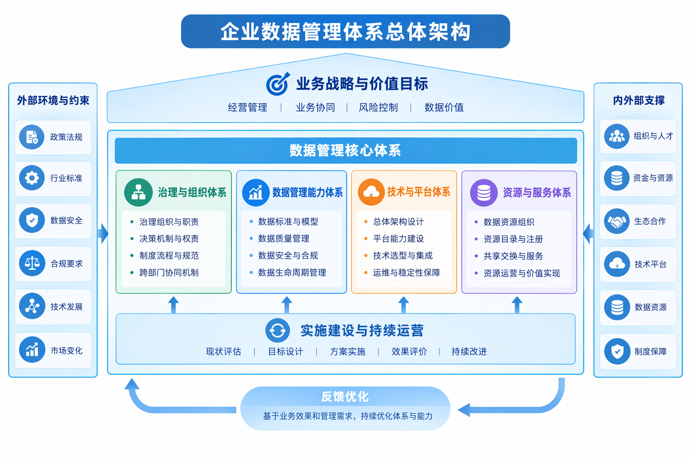
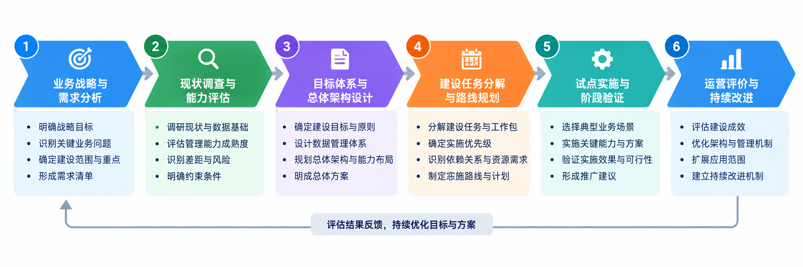

# 第14章 企业数据管理总体方法论

企业数据管理涉及战略规划、组织治理、数据架构、专业管理能力、技术平台与资源运营等多个方面。对于解决方案架构师而言，关键工作并非逐项罗列建设内容，而是以业务战略和价值目标为起点，形成能够统筹管理责任、数据能力、技术支撑和实施路径的总体设计。本章建立企业数据管理的总体方法框架，明确体系的组成关系、生命周期控制、能力评价、架构决策、治理组织和建设路线，为企业开展数据管理规划与工程建设提供统一的设计依据。

总体方法首先回答企业需要形成什么样的数据管理能力、各类能力如何相互支撑，再回答如何评估现状、如何选择架构方案、如何组织建设和评价成效。对于多组织、多系统的集团型企业，这一方法既需要处理总部统一要求与所属企业专业自治之间的关系，也需要兼顾长期管理目标与阶段实施条件。以下以大型制造集团的典型管理问题作为说明场景，但总体架构及工作方法不以特定行业或部署形态为前提。

## 14.1 企业数据管理体系

### 14.1.1 体系设计的出发点

企业数据管理体系的设计通常从业务目标和管理问题开始，而不是从技术产品清单开始。企业可能已经拥有数据仓库、数据中台、报表系统以及一套数据标准，但经营指标仍存在口径争议，业务部门仍需要人工核对报表，跨企业数据共享仍依赖临时协调。这类问题表明，单项技术能力和管理成果并未形成有效的工作关系。总体设计首先要识别数据问题发生在业务定义、组织责任、数据生产、加工传递还是使用环节，区分可以通过技术改造解决的问题与必须依靠管理机制解决的问题。

对于集团型制造企业，可以从集团经营分析、供应链协同和质量追溯等业务活动出发，分析哪些决策依赖跨组织数据，哪些关键对象必须形成一致理解，哪些数据质量问题直接影响业务判断。在此基础上确定总体目标、覆盖范围和建设边界。集团要求经营指标可比较，不意味着所属企业必须统一全部业务系统；要求跨企业质量追溯，也不意味着全部工艺数据必须集中。体系设计需要把统一管理的必要范围与企业保留的专业管理空间同时说明。

### 14.1.2 体系构成与相互关系

企业数据管理总体架构由业务战略与价值目标牵引，以治理与组织、数据管理能力、技术与平台、资源与服务四类体系为主体，以实施建设和持续运营形成管理闭环。业务目标决定建设的必要性和优先级；治理与组织体系提供决策权限和管理责任；数据管理能力体系建立标准、模型、质量、安全和生命周期控制；技术与平台体系提供数据处理和服务的技术基础；资源与服务体系将可管理的数据转化为业务可使用的资源和服务。四类体系相互配合，任何一类长期缺位都会影响整体运行效果。

总体架构不是将所有工作简单分层，而是明确层次之间的约束和反馈关系。业务部门提出目标并确认结果，治理机制形成规则和责任，专业能力把规则转化为可执行要求，技术平台承载处理与服务，资源运营记录使用、质量和变更情况，再将评价结果反馈至目标、规则和架构调整。以集团交付及时率为例，业务部门首先确认统计对象和口径，数据管理部门组织规则审批，技术团队实现跨系统关联与计算，运营环节通过对账和变更监测保持结果稳定。由此，体系架构成为后续方案设计、职责分解和成果验收的共同依据。

| 体系要素 | 架构设计要回答的问题             | 典型交付成果                 |
|----------|----------------------------------|------------------------------|
| 战略规划 | 服务哪些业务目标，先解决哪些问题 | 目标与范围、优先级、投资边界 |
| 治理组织 | 谁决策、谁负责、争议如何协调     | 组织职责、决策权限、责任矩阵 |
| 管理制度 | 哪些活动需要标准化、审批和留痕   | 制度清单、流程与控制点       |
| 专业能力 | 关键能力具备到什么程度           | 能力评价、差距与改进任务     |
| 技术架构 | 现有系统与新增能力如何协同       | 架构原则、能力布局、选型约束 |
| 资源运营 | 项目完成后如何维护和衡量效果     | 运营职责、服务指标、改进机制 |

### 14.1.3 总体设计的工作成果

总体设计需要形成能够相互对应的成果体系：业务目标与数据需求对应关系、现状能力与目标能力差距、治理组织和责任矩阵、目标架构与关键决策、建设任务组合与总体路线图，以及阶段评价与运营承接要求。这些成果不是相互独立的文档集合。每项建设任务应能够追溯到业务目标和能力差距，每项架构决策应具有约束条件和备选方案依据，每项验收要求应能够验证相应的业务效果或管理能力。

总体架构需要保留必要的演进空间。业务范围调整、组织重组、关键系统升级或监管要求变化，都可能影响原有设计假设。架构师应维护关键决策记录，区分已经确认的约束、待验证的技术假设与需要管理层裁决的事项，并将这些变化纳入总体架构的定期评审。总体架构由此既是建设初期的指导方案，也是后续管理和技术调整的共同参照。

图14-1 企业数据管理体系总体架构

## 14.2 数据资产生命周期

### 14.2.1 从数据生命周期到资产管理责任

数据生命周期描述数据从产生、获取、加工、使用、维护到归档和处置的变化过程；数据资产生命周期管理则进一步关注数据在不同阶段的管理责任、使用条件、质量状态、维护成本和业务价值。企业内部的数据并不因为被采集或编目就自动成为具备稳定使用价值的资产。总体方法需要明确哪些资源应纳入重点管理，哪些数据只是过程性记录，哪些资源因保密、合同或保留期限要求受到限制。不同类型资源可以采用不同的管理强度，但都应明确必要的责任与控制要求。

制造企业的数据往往具有较长的业务关联周期。产品结构、工艺版本、生产批次、检验结论和售后事件之间的关系，可能在交付多年后仍用于追溯。与此同时，部分高频设备原始数据保存成本较高，业务价值可能主要体现在聚合指标和异常事件中。因此，生命周期设计需要同时考虑业务追溯价值、更新频率、数据体量、保存依据和使用成本，不能为全部数据规定相同的存储和保留策略。

### 14.2.2 生命周期控制点与责任转移

生命周期管理的关键在于明确每个环节的控制点。数据形成阶段关注来源、业务定义、合法处理依据和源头质量；加工阶段关注转换规则、关联依据、版本和血缘；发布阶段关注责任确认、分类分级、授权条件与服务承诺；使用阶段关注用途限制、质量反馈、变更通知与审计；退出阶段关注订阅解除、历史保留、归档和删除。各阶段既有技术活动，也有业务确认事项，不能简单地交由单一技术部门完成。

当数据由源系统进入共享服务，责任并不是一次性从业务部门转交给平台团队。源系统责任部门仍需保证业务事实和源头规则，数据加工团队负责转换过程的正确性，指标责任部门确认统计口径，服务运营团队维护发布与订阅关系。发生质量问题时，应根据数据血缘和责任边界定位处理主体；发生业务定义变更时，则由具有相应业务决策权的部门确认新规则及其生效范围。

| 阶段 | 主要管理决策 | 需要保留的证据 |
|----|----|----|
| 形成与获取 | 采集是否必要、来源是否合法、责任归谁 | 来源、业务定义、采集依据 |
| 加工与组织 | 如何关联、转换与追溯 | 映射规则、血缘、版本 |
| 登记与发布 | 能否共享、向谁共享、服务条件是什么 | 分类分级、审批、服务契约 |
| 使用与维护 | 质量如何反馈、变更如何通知 | 订阅记录、质量报告、变更记录 |
| 归档与退出 | 何时停用、何时保留或删除 | 保留依据、退出审批、处置记录 |

### 14.2.3 价值评价与退出决策

数据资产价值评价应与具体业务用途关联。对于集团经营指标，可以检查其是否减少人工对账、提高统计一致性和缩短经营分析准备时间；对于质量追溯数据，可以检查追溯范围、定位时间和历史版本完整性。调用次数、资源数量和数据体量可以作为运营参考，但不足以独立证明业务价值。总体设计应在资源进入重点建设范围时就明确预期使用主体、业务基线和评价方式，为后续投资复盘提供依据。

资源退出需要综合业务使用情况、法律法规、合同义务、审计与追溯要求判断。低频使用并不等于可以删除，已失效也不意味着必须永久保留。对于需要长期追溯的历史记录，可以采取归档与受控访问；对于已取消授权的共享服务，应停止后续访问并按约定处理已交付数据。生命周期管理的成熟程度，最终体现在企业能否解释资源为什么存在、由谁维护、用于何处以及何时退出。

## 14.3 数据管理能力模型

### 14.3.1 能力评价的目标与对象

数据管理能力模型用于判断企业是否具备持续完成数据管理任务的组织、流程、规则和技术条件。评价对象是实际管理能力，而不是项目采购规模或软件功能数量。企业即使部署了元数据管理平台，如果关键资源的业务定义长期无人维护，元数据管理能力仍然存在缺口；即使建立了数据质量规则库，如果问题没有责任人、整改期限和复检记录，质量管理也不能视为有效运行。能力评价应以可核查的工作证据为基础。

集团型企业不宜只给出一个总体成熟度分数。集团总部、事业部和生产企业承担的职责不同，业务域的数据基础也可能存在明显差异。评价时应先确定组织范围、业务场景和能力域，再分别检查公共管理能力、专业业务能力和跨组织协同能力。对于经营分析，重点可能是指标定义、公共标识和对账；对于质量追溯，重点则可能是产品版本、批次关联和历史记录完整性。评价范围应与建设目标保持一致。

### 14.3.2 评价维度与分级标准

能力评价可以设置战略与组织、标准与主数据、架构与模型、元数据与目录、数据质量、安全与共享、资源运营等维度。为便于不同部门理解和复评，可以采用五级描述：一级为零散开展，主要依赖个人经验；二级为局部规范，部分业务域形成固定做法；三级为制度化运行，职责、规则和流程得到明确执行；四级为量化管理，关键活动具有稳定指标并能根据结果调整；五级为持续优化，管理机制能够跨组织复用并随业务变化改进。这里的分级属于本书建议的项目评价尺度，不等同于任何外部认证标准。

评价时需要区分“有制度”“已执行”和“有效果”。例如集团制定了供应商编码规范，只能证明标准已经形成；企业实际使用集团标识并持续维护映射，才能证明制度执行；跨企业供应商统计差异下降、重复主体得到识别，才体现管理效果。不同证据对应不同层级，不应因为存在一份制度文件就将该能力评为成熟。对尚未具备可核查数据的指标，可以记录证据不足，不必强行赋分。

| 能力等级     | 状态描述                     | 典型判定依据                   |
|--------------|------------------------------|--------------------------------|
| 1 零散开展   | 依赖临时协调与个人经验       | 缺少稳定责任与执行记录         |
| 2 局部规范   | 部分单位或场景形成固定做法   | 局部规则、重复执行记录         |
| 3 制度化运行 | 职责、流程和规则得到常态执行 | 责任人、审批、工单和复检证据   |
| 4 量化管理   | 关键活动有指标并用于管理     | 趋势监测、偏差分析、纠正措施   |
| 5 持续优化   | 可复用并能随业务变化改进     | 跨组织推广、周期复评、改进成效 |

### 14.3.3 证据采集与差距分析

实际评估可采用访谈、制度审查、系统检查、业务样本抽查和运行记录核验相结合的方法。访谈用于了解管理分工和问题背景，文件用于确认规则是否存在，系统和记录用于判断规则是否执行，业务样本则用于验证结果是否可信。评估人员应为每项判断记录证据来源、覆盖组织、时间范围和适用条件，避免将某个试点部门的良好表现直接推断为集团整体能力。

差距分析应进一步解释能力不足对业务的影响。例如“主数据管理二级”本身不足以指导建设，还需要指出供应商跨企业映射缺失导致采购统计无法合并，或产品版本关联不完整影响质量追溯。差距条目宜包含现状、目标、证据、业务影响、责任主体、依赖条件和建议措施。对存在争议的评价结果，应保留不同业务部门的意见并组织复核，而不是为了得到统一评分而忽略真实分歧。

## 14.3.4 从能力差距形成改进组合

能力改进不宜按照所有维度同步提升的方式安排。总体架构师应把能力差距映射到业务场景，识别其中的前置条件、共同依赖和可复用成果。例如经营分析与供应链协同都依赖组织、供应商和物料标识，可以优先建设公共映射机制；质量追溯则需要优先保证产品版本和检验批次的历史关系。若业务定义尚未确认，提前建设复杂的数据处理任务可能造成返工。

优先级可以综合业务影响、实施可行性、组织准备程度、依赖关系和风险确定，并明确哪些问题适合通过试点验证、哪些问题必须先由管理层作出决策。能力评价应在重要阶段后复评，重点检查原有差距是否缩小、制度是否稳定运行、业务问题是否改善，而不是仅比较两次总分。

## 14.4 企业数据平台总体架构

### 14.4.1 总体架构的设计输入

企业数据平台总体架构首先是一组设计决策，而不是某一种技术产品的部署图。架构设计应接收业务场景、数据特征、现有系统、非功能要求和管理约束等输入。业务场景说明需要支持什么决策或业务活动；数据特征说明数据规模、更新频率、结构和历史保留要求；现有系统说明可复用能力与改造边界；非功能要求包括性能、可用性、恢复能力和可维护性；管理约束则涉及组织权限、跨法人共享、工业网络边界和成本。输入不清楚时，过早确定技术架构容易使后续方案围绕既定产品寻找需求。

在集团制造场景中，经营分析、供应链协同和设备状态分析对平台的要求并不相同。经营分析强调指标口径和历史可比较性，供应链协同强调业务状态变化与跨企业标识关联，设备状态分析则可能强调高频采集、边缘处理和网络隔离。总体架构需要先识别这些差异，再判断哪些能力可以共享，哪些能力应保持专业化，而不是要求所有场景采用完全相同的数据流转模式。

### 14.4.2 架构原则与能力边界

总体架构可以确立业务系统职责不变、公共能力优先复用、数据按需流动、统一管理与专业扩展并存、全链路可追溯、安全控制前置等原则。这些原则需要转化为可检验的设计约束。例如“按需流动”应落实为明确的共享对象、字段范围和更新方式；“优先复用”应落实为对既有采集、存储和计算组件的适配评估；“可追溯”应落实为来源标识、处理规则、版本和血缘记录。缺少具体约束的架构原则难以用于方案评审。

能力边界应区分业务事务处理、企业数据处理、跨企业共享控制和业务应用服务。业务系统保持业务事实的生产和更新职责，数据平台承担跨系统加工与服务，管理机制决定公共规则与共享权限，应用系统消费数据产品并反馈质量问题。不同企业可以采用集中部署、分布部署或混合部署，但无论选择哪一种，都应明确数据责任、故障影响范围、管理成本和后续扩展方式。具体采集、存储、计算与服务组件的工程实现由第15章展开。

### 14.4.3 架构方案的比较与决策记录

架构评审不宜只比较技术性能，还应比较现有投资保护、数据流动成本、组织协同复杂度、运维能力、合规约束和业务连续性。集中式方案可能便于统一运营，却会增加中心依赖和数据传输压力；分布式方案有利于数据属地管理，却对统一标识、目录、服务契约和运行监测提出更高要求；混合式方案可以兼顾差异，但需要明确哪些能力集中、哪些能力分散以及如何保持一致。选择应以具体业务和约束为依据，不应将某种部署方式预设为普遍最优。

| 决策事项           | 需要比较的因素                   | 应形成的结论       |
|--------------------|----------------------------------|--------------------|
| 现有平台复用       | 能力匹配、改造成本、运维成熟度   | 复用范围与补充能力 |
| 集中或分布部署     | 时效、数据量、安全边界、网络成本 | 节点与能力布局原则 |
| 数据汇聚或按需访问 | 使用频率、敏感性、追溯要求       | 共享粒度与交付方式 |
| 公共模型范围       | 跨企业一致性、专业差异、变更成本 | 公共属性与扩展边界 |
| 技术选型           | 兼容性、性能、成本、团队能力     | 候选方案及验证要求 |

重要架构决策应记录问题背景、备选方案、选择依据、适用条件和潜在风险。对尚不能确认的性能、兼容性或数据质量假设，可以通过概念验证或小范围试点形成证据，再决定是否推广。这样形成的架构不仅能够指导项目建设，也便于后续在组织、技术和业务条件变化时重新评估。

## 14.5 数据治理总体架构

### 14.5.1 治理架构首先是决策权设计

数据治理总体架构需要明确企业如何对公共数据规则、管理责任和重大争议作出决定。对于集团企业，治理架构至少涉及集团统一事项、事业部专业事项和所属企业源头事项的分工。集团可以统一公共对象定义、跨企业指标和共享规则，事业部负责产品线相关专业标准，所属企业负责本地数据质量与业务流程中的实际执行。具体权限不能仅按组织级别机械划分，还应考虑数据产生位置、业务专业性、法律主体和风险承担方式。

治理组织应区分决策、协调、执行与监督。业务责任人确认业务定义和使用要求，数据管理部门组织规则维护与跨部门协调，技术团队负责实现控制和提供运行证据，审计或合规职能按照企业制度监督相关活动。对于跨部门指标口径争议，应明确提出、分析、裁决和生效的流程；对于跨法人数据共享，应由有权主体确认用途、范围与协议条件。没有明确决策权的治理委员会，即使定期开会，也难以解决实际问题。

## 14.5.2 责任矩阵与制度体系

治理职责需要落到具体活动而不是停留在部门名称。可以针对公共数据标准发布、主数据变更、质量问题整改、共享授权、服务下线等事项建立责任矩阵，分别明确提出人、审核人、批准人、执行人和知会对象。一个事项应有清晰的最终决策主体，同时允许多个部门参与专业审查。对于组织调整和人员变更，还应有责任交接机制，避免目录和质量规则长期无人维护。

制度体系宜从高频且影响较大的管理活动入手，先形成少量可执行的规则，再随着运营证据积累逐步完善。制度不仅需要描述审批流程，还要明确触发条件、处理时限、例外情形、记录要求和争议升级路径。例如数据标准发生重大变更时，应检查下游使用范围、安排兼容期并通知相关责任单位；质量问题长期无法整改时，应判断是源头系统约束、业务定义争议还是资源不足，分别采取处理措施。

| 治理事项     | 业务决策责任               | 执行与协同责任                     |
|--------------|----------------------------|------------------------------------|
| 公共指标口径 | 指标所属业务管理部门       | 数据管理部门组织协调，技术团队实现 |
| 主数据变更   | 对象所属业务责任部门       | 数据管理员维护映射与版本           |
| 源头数据质量 | 数据产生单位业务责任人     | 系统负责人、数据管理员协同整改     |
| 跨企业共享   | 有权审批的资源责任主体     | 安全合规、服务运营和技术团队       |
| 资源服务停用 | 资源责任人与主要使用方确认 | 运营团队执行通知与退出             |

### 14.5.3 治理机制如何嵌入业务

治理活动需要嵌入业务过程，才能形成稳定执行。供应商信息的创建和变更应与采购管理流程衔接，产品和物料编码应与研发、工艺及生产管理衔接，经营指标口径应与报表发布和经营分析衔接，质量问题整改应与源系统责任部门的日常工作衔接。治理平台可以支持审批、校验、工单和审计，但不能替代业务确认。对于已经稳定运行的业务流程，优先考虑增加必要控制点，而不是另建一套重复审批机制。

治理成效需要同时从规则执行和业务结果两个方面观察。制度覆盖率、问题整改时长、规则通过率能够反映治理运行状况，跨企业统计差异、人工对账工作量、追溯完整性和服务可用性则更接近业务效果。评价指标应与责任主体对应，不能将技术团队无法控制的源头业务错误全部归入平台运维考核。具体资源质量和共享运行机制在第16章展开，本节重点是建立能够持续作出决策并推动整改的治理组织与制度基础。

## 14.6 企业数据管理路线图

### 14.6.1 建设路线的形成方法

企业数据管理总体路线图以业务战略和价值目标为起点，依次开展业务与需求分析、现状调查与能力评估、目标体系与总体架构设计、建设任务分解与路线规划、试点实施与阶段验证，最终进入运营评价与持续改进。上述环节构成架构师开展总体设计和组织落地的基本工作路径，并通过评价反馈不断修正目标、架构和任务组合。它描述的是企业数据管理的决策与实施方法，而不是要求所有项目机械执行相同的建设阶段。

图14-2 企业数据管理总体实施路线

路线规划应从目标、差距和依赖关系推导。总体规划首先确定需要改善的业务结果，随后根据能力评价识别约束条件，再把这些约束转化为可交付的管理与技术任务。对于每项任务，应说明对应的业务问题、前置条件、责任部门、预期成果和验证方法。若多个业务场景依赖同一公共能力，应优先考虑统一建设；若某项能力只有单一场景使用，则需要判断是否适合通过试点验证后再扩大投入。

### 14.6.2 任务优先级与依赖管理

任务优先级需要综合业务影响、实施成本、技术可行性、组织准备程度和风险。业务价值较高但数据来源不稳定的场景，可以先开展数据可获得性验证；技术实现容易但业务责任不明确的场景，应先落实管理决策；能够同时支持多个业务目标的公共能力，可以适当提前安排。路线图还应标识任务之间的依赖，例如统一指标计算依赖业务口径确认，跨企业实体关联依赖标识映射，正式共享依赖授权边界和服务契约。

在项目组合管理中，应区分基础性任务、场景性任务和持续性任务。基础性任务形成公共规则、管理组织与共享能力，场景性任务围绕具体业务链路形成可用成果，持续性任务负责运营、复评与变更管理。三类任务可以交叉推进，并不意味着基础性任务必须全部完成后才允许开展场景建设。关键是保证试点所依赖的条件已经具备，并对尚未解决的问题设定明确的风险控制。

| 任务类型 | 主要内容 | 优先安排依据 |
|----|----|----|
| 公共基础任务 | 公共标识、责任机制、指标标准、共享原则 | 多场景共用、依赖程度高 |
| 业务场景任务 | 经营分析、交付协同、质量追溯 | 业务影响明确、可形成验证样本 |
| 验证性任务 | 数据可获得性、技术兼容性、业务口径试算 | 不确定性高、需先取得证据 |
| 运营改进任务 | 目录维护、质量复评、服务变更 | 保障成果持续可用 |

### 14.6.3 阶段决策与验收机制

路线图应设置阶段性决策点，但不宜把某一固定时间表当作通用建设方法。阶段决策至少检查三方面条件：数据条件是否满足目标场景，业务部门是否确认结果可用，组织是否具备持续维护和运行能力。对于未达到要求的事项，应区分需要整改、需要调整范围还是需要暂停推广，并记录决定依据。阶段验收应以业务样本和运行证据为基础，不能仅以系统上线、接口数量或文档交付作为判断标准。

以跨企业交付分析为例，试点验收应检查典型订单的标识关联是否正确，变更、拆分和取消等业务情形是否得到处理，指标结果能否与业务系统核对，异常数据是否能够定位责任部门。只有当这些条件具备且使用部门认可结果时，才有充分依据将相同模式推广到更多企业。第16章将进一步讨论资源体系项目的具体实施阶段；本节关注的是企业如何建立统一的投资决策、项目组合管理和推广准入机制。

### 14.6.4 从项目建设到能力运营

路线图不能在系统验收时结束。数据管理体系需要明确项目成果向日常管理组织移交的条件，包括规则维护责任、资源服务责任、运行指标、变更流程和预算安排。公共模型、目录和质量规则会随着业务系统、组织结构和管理口径变化而持续调整，若缺少运营承接，项目交付时形成的能力可能逐渐失效。因此，总体规划阶段就应明确哪些工作属于一次性建设，哪些工作需要常态化人员和经费支持。

企业通过周期性能力复评、业务场景效果核查和架构决策回顾，判断下一阶段应扩大建设范围、优化现有能力还是调整技术路线。总体方法论的成果，是一套能够解释建设选择、落实管理责任、验证业务效果并持续改进的工作机制。在此总体框架指导下，企业数据平台建设进一步落实技术能力与运行保障，数据资源体系建设进一步落实资源组织、跨主体协同和共享运营，共同构成企业数据管理体系的工程实施内容。
