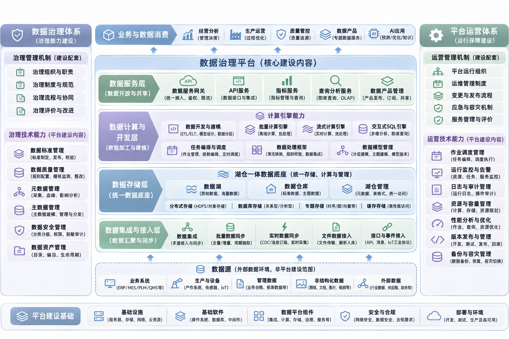

# 第15章 企业数据平台建设实践

企业数据平台建设的任务，是在既有业务系统和基础设施条件下，形成一套能够持续接入数据、组织存储资源、开发与执行数据计算任务、对外提供数据服务，并具备治理和运行保障能力的技术平台。对于大型集团企业而言，这项工作不仅涉及数据库、计算引擎或数据集成工具的选择，更涉及组件职责、系统集成、资源部署、技术依赖、建设顺序和验收边界的确定。平台建设是否成功，应当以能力是否真正建成、组件是否协同、业务消费是否可用、后续是否能够维护和扩展为判断依据。

本章以总体建设能力架构为主线组织内容，以某大型轨道交通装备制造集团的跨系统数据平台建设需求为贯穿场景。集团总部、事业部、生产企业和生产基地存在ERP、MES、PLM、QMS、WMS、工业设备和文档系统等多类数据来源，既需要统一的经营与生产分析，也需要在权限、网络和属地管理约束下保留必要的分布式处理能力。以下讨论重点是为这些需求配置和建设可运行的平台技术能力。

## 15.1 总体建设架构与平台边界

### 15.1.1 建设目标与能力范围

企业数据平台的建设目标，应当从业务消费需求反向确定技术能力，再通过组件建设与系统集成形成可交付的平台。平台向下对接业务数据库、工业设备、文档和外部数据，向上支撑经营分析、生产运营、质量管控、数据产品和AI应用，中间需要具备数据集成、存储、计算开发和数据服务四类核心技术能力。数据治理和平台运营分别提供公共管理与技术支撑，基础设施、基础软件、安全合规及部署环境构成工程底座。图15-1展示的是建设能力架构，不是数据流转顺序图，也不是某家厂商的产品功能清单。

平台范围首先要与源系统和消费应用划清边界。ERP中的订单状态、MES中的工单执行记录、PLM中的产品版本以及QMS中的质量检验结果，原则上仍由各自业务系统负责产生和维护。数据平台可以按授权获取、保存和加工这些数据，但不能因为形成了汇总结果就自动成为原始业务事实的权威系统。经营驾驶舱、生产看板和AI业务应用通常由相应应用系统建设，平台负责提供数据接口、指标、查询、数据产品或必要的分析能力；只有在项目范围明确约定时，才将可视化前端或业务应用一并纳入交付。

建设范围还应区分“新建、复用、改造、集成”四种实现方式。企业可能已有数据库、对象存储、ETL工具、BI平台、统一身份认证、监控系统或主数据管理系统。总体架构要求覆盖相关能力，不等于必须为每个方框采购一套独立产品。方案设计需要先核查现有能力的接口、性能、许可证、维护状态和扩展边界，再决定由现有组件承担还是补充建设。这样既可以避免重复投资，也能降低多产品集成造成的运维复杂度。

### 15.1.2 总体建设能力架构

*图15-1 企业数据平台总体建设能力架构*

图中主体由下至上为数据集成与接入层、数据存储层、数据计算与开发层、数据服务层；数据源是外部输入环境，业务与数据消费是外部需求和成果应用环境。数据集成与接入层重点建设多源连接、批量同步、实时同步、文件数据接入及接口事件接入组件；数据存储层建设湖仓一体数据底座及必要的专业存储和缓存；数据计算与开发层建设数据开发建模工具、批量计算引擎、流式计算引擎、交互式SQL引擎和数据处理框架；数据服务层建设数据服务网关、API服务、指标服务、查询分析服务与数据产品管理能力。

左侧数据治理体系分为治理管理机制与治理技术能力，后者包括数据标准、质量、元数据、主数据、安全和数据资产管理工具。右侧平台运营体系同样区分管理机制与运行技术能力，后者包括作业调度、监控告警、日志审计、资源容量、性能优化、版本发布和备份容灾。两侧支撑能力与主体技术链路逻辑解耦，通过规则接口、执行控制、元数据采集、调度指令、运行日志和状态反馈发生协作，而不是要求每条数据都依次流经治理工具或运维工具。

图中使用“湖仓一体数据底座”表达统一存储、计算协同和管理能力，但逻辑分层仍需要区分存储引擎与计算执行引擎。数据湖、数据仓库和湖仓管理能力属于底座内部的组织与技术机制，不宜直接解释为三套必须分别采购的产品。图中“任务编排与调度”属于开发工具提供的任务定义、依赖设计和调试能力；右侧“作业调度管理”属于生产运行中的触发、队列、执行控制和故障恢复能力。实际产品可以集成两者，但职责不能重复计算。

### 15.1.3 从架构图形成建设清单

总体架构只有转化为工程清单，才具有实施价值。每一项能力至少需要落实到功能边界、实现方式、候选产品或现有组件、部署单元、接口关系、资源需求、责任主体和验收指标。对于数据同步组件，应当明确支持的源数据库类型、全量与增量策略、CDC方式、网络连接、同步延迟和失败恢复；对于计算引擎，应当明确计算模式、资源调度、作业隔离、开发接口和运行性能；对于数据服务，应当明确接口规范、身份鉴别、权限、并发、限流、监测和版本兼容。

| 建设域 | 主要组件或能力 | 核心交付物 | 与其他建设域的依赖 |
|---|---|---|---|
| 数据集成与接入 | 数据源连接器、批量同步、实时同步、文件与接口接入 | 接入组件、连接配置、同步任务、校验与恢复机制 | 网络、源系统授权、目标存储 |
| 数据存储 | 湖仓底座、对象/文件存储、分析数据库、专业存储、缓存 | 存储集群、表格式与元数据配置、容量与恢复方案 | 计算引擎、数据目录、基础设施 |
| 数据计算与开发 | 开发建模工具、批处理、流处理、SQL引擎、处理框架 | 开发环境、执行引擎、模型与任务管理能力 | 存储、调度、版本发布 |
| 数据服务 | 服务网关、API、指标、查询分析、数据产品管理 | 服务接口、服务契约、授权与监测能力 | 计算与存储、身份认证、业务应用 |
| 数据治理支撑 | 标准、质量、元数据、主数据、安全、资产管理工具 | 规则库、管理工具、执行接口、反馈闭环 | 各主体组件的执行点 |
| 平台运行支撑 | 调度、监控、日志、资源、发布、备份恢复 | 运维工具、运行配置、告警与恢复能力 | 所有生产部署单元 |
| 建设基础 | 基础设施、基础软件、安全合规、环境 | 网络与资源配置、环境基线、安全配置 | 全部组件 |

### 15.1.4 建设架构与数据逻辑架构的区别

ODS、DWD、DWS、ADS是数据加工与组织中常见的逻辑分层，订单、产品、生产、质量等是面向业务语义的主题域，订单履约和质量成本等则可能构成面向应用的专题数据。这些内容需要在平台建成后通过建模、开发和运行任务逐步形成，但本身不是独立的技术组件。平台建设应提供支持这些组织方式的数据建模工具、元数据管理、计算引擎、存储表管理及发布机制，而不是把ODS、DWD、DWS、ADS当作四套软件产品。

数据逻辑架构可以先于数据加工任务完成设计，并指导加工任务的开发；具体数据结果则在接入、落地、标准化、主题加工和专题交付过程中形成。对于企业现有数据仓库，ODS、DWD、DWS、ADS的命名可以延续；对于以湖仓为主的技术方案，也可以采用贴源、标准明细、公共主题和应用数据等描述。无论采用哪种命名，均不应要求所有实时事件、文件或专业索引机械地经过全部分层。

### 15.1.5 建设约束与技术决策

总体方案需要在立项和初步设计阶段确定关键非功能约束，包括数据源规模、每日增量、文件容量、同步时效、计算窗口、并发查询、服务响应、保留周期、网络带宽、数据安全边界、恢复时间目标和恢复点目标。上述指标必须尽可能由现状测量、业务需求或容量预测提供依据，而不能只根据产品宣传指标填写。对尚无法确认的参数，应明确假设、验证方法及变更触发条件。

集团型企业还需要确定集中、分布或混合部署策略。总部可以建设公共数据底座与统一服务能力，生产基地在网络隔离或高频设备采集条件下保留边缘接入和本地处理组件。总部是否汇聚原始明细，应根据业务需要、权限、成本和网络条件确定；并非所有数据都应先集中到总部。与第16章的分级数据资源体系不同，本章主要讨论这些节点所依赖的技术平台如何建设、部署和集成，不展开跨组织资源授权与目录运营制度。

## 15.2 平台建设基础与环境准备

### 15.2.1 基础设施与部署资源

基础设施建设需要覆盖计算、存储、网络和云资源，并明确生产、测试、开发等环境的资源边界。计算资源应区分常驻服务、批量计算、流式计算、交互查询和治理运维等不同负载，避免将全部组件部署在没有资源隔离的共享节点上。存储资源应分别测算原始文件、湖仓表、专业数据库、索引、日志、备份和计算临时空间。网络设计则需考虑源系统接入链路、跨安全域访问、计算存储访问、服务出口及备份链路的带宽和可靠性。

资源测算应以工作负载为基础，而不是简单按节点数量乘以经验配置。对于每日定时运行的批量任务，应测算批处理窗口、峰值并发和历史重算所需的额外资源；对于持续运行的流计算，应测算事件速率、状态大小、检查点频率和故障恢复期间的积压量；对于服务网关和查询引擎，应测算请求峰值、响应目标与缓存命中情况。生产环境还应保留必要的扩容余量，并建立容量监测和调整机制。

### 15.2.2 基础软件与平台组件

基础软件包括操作系统、容器或虚拟化环境、数据库、中间件、证书和密钥服务、时间同步、统一认证、软件仓库以及必要的集群管理能力。数据平台组件需要与这些基础软件形成经过验证的兼容组合。版本选择应关注长期维护、驱动和连接器兼容、漏洞修复、许可证约束以及升级路径，避免在建设初期采用大量缺乏维护保障的组件版本。

平台建设不能仅提交组件安装记录，还应形成配置基线、组件依赖关系、网络端口清单、账号权限清单、部署脚本、配置备份及升级回退方案。对于由不同厂商提供的数据集成、存储、计算和服务组件，需要明确统一认证、元数据接口、日志采集、监控接入和故障定位责任，否则平台表面上功能完整，实际运行中仍可能形成互不协同的工具孤岛。

### 15.2.3 安全合规与多环境管理

平台安全设计应覆盖身份鉴别、访问授权、网络隔离、传输加密、存储加密、密钥管理、操作审计、数据分类分级和敏感数据处理。安全能力既有基础设施层面的网络与主机控制，也有数据平台层面的表、列、行、API和数据产品授权。治理工具可以集中管理策略，但执行控制应落实到存储、查询和服务等实际访问入口。涉及军工、重要工业数据或其他特定管理要求时，还应按项目适用的法律法规、保密制度和单位内部规范确定部署与交换边界。

开发、测试和生产环境需要形成清晰的发布与数据隔离机制。开发人员应通过受控的开发环境进行模型设计、任务测试和接口联调，不宜直接在生产集群修改作业；测试环境应提供代表性数据规模与数据特征，但不得以无控制复制生产敏感数据的方式准备测试集。配置参数、连接凭据和密钥应由受控配置管理机制提供，避免直接写入代码仓库或交付文档。

## 15.3 数据集成与接入组件建设

### 15.3.1 数据源调查与连接器体系

数据集成与接入层的建设起点是数据源调查和连接器能力规划。源系统调查至少包括系统名称、责任部门、数据库或协议类型、数据对象、数据规模、更新频率、允许访问方式、网络边界、业务高峰和源系统性能约束。对于ERP、MES、PLM、QMS等核心系统，应优先确认厂商支持的数据接口或只读访问机制，避免未经评估直接读取高负载生产库。对于设备、工业网关和边缘采集系统，应关注协议适配、采样周期、时间戳质量、网络断连与本地缓存能力。

连接器体系应将源系统适配与同步执行机制适度解耦。连接器负责协议、认证、数据类型映射、源端读取和目标写入适配；同步组件负责调度触发、并发、增量状态、传输重试和结果校验。这样既便于扩展新数据源，也有利于统一任务监控和运行规范。对于无法直接连接的外部系统，可采用文件交换、受控API或消息中转等方式，不应为了统一技术栈而强行要求源系统改造。

### 15.3.2 批量数据同步组件

批量同步组件面向周期性抽取和批次传输场景，应具备全量同步、基于时间戳或业务标识的增量抽取、分片并发、断点续传、字段映射、数据校验和任务重跑能力。全量与增量描述的是数据选择策略，批量描述的是任务运行和传输方式，两者并非同一分类维度。周期性增量同步既可以采用查询条件，也可以使用源系统提供的变更记录，具体方案需要考虑删除记录识别、晚到更新和源库索引压力。

批量同步工具的建设重点在于可重复执行和可核对。任务应记录源端时间范围、批次标识、读取记录数、写入记录数、失败记录、执行耗时和目标数据版本。对于批次失败后的重跑，需要通过幂等写入、分区覆盖、业务主键去重或事务控制避免重复数据。对于大表首批全量导入，可采用离线导出、并发分片或专用迁移通道，但应预先评估源库压力、网络窗口和目标存储写入能力。

### 15.3.3 实时数据同步组件

实时同步组件主要面向数据库变更、业务事件和设备事件的持续接入。数据库CDC组件需要支持源端日志解析、变更位点管理、事务边界识别、初始快照与后续增量衔接、断线恢复及必要的表结构变化处理。消息接入组件需要具备订阅管理、消费位点、积压监测、重试和死信处理等能力。对实时性要求较高的生产状态和设备监测场景，应明确事件时间、接收时间和处理时间的区别，并考虑时钟偏差及乱序数据。

实时同步组件与流计算引擎应分别建设或分别界定职责。实时同步负责将变化可靠送达目标或消息通道；流计算负责窗口聚合、状态计算、事件关联和连续指标更新等处理。只需要把源端变更复制到目标库的场景，可以不部署流计算作业。反之，流计算引擎也可能消费由API或设备网关产生的事件，而不依赖数据库CDC。两者之间应通过消息、流表或其他受控接口建立契约，明确数据格式、重放策略和故障恢复语义。

### 15.3.4 文件数据与接口事件接入组件

文件接入能力面向CSV、Excel、XML、JSON、图纸、检验报告、图片和视频等对象，需要支持上传、批量传输、目录监听、格式识别、完整性校验、病毒检查、元数据登记和失败重传。结构化文件可在解析后形成表数据，非结构化文件则通常保存在对象或文件存储中，并通过元数据、业务标识和检索索引提供访问。文件接入不能简单等同于数据库同步，其版本、大小、校验和权限要求往往不同。

API和事件接入组件承担对外系统的接口对接与事件订阅。API接入应关注身份认证、分页、限流、超时、重试、接口版本和调用审计；消息接入应关注主题、消费组、顺序要求、重复投递和消息积压。工业协议适配需要考虑网关和现场系统的可靠性，不宜让中心平台直接承担所有设备协议连接。对于存在严格网络分区的生产环境，可以通过边缘网关完成协议转换、缓存和受控上送。

### 15.3.5 组件集成、可靠性与验收

数据接入层的验收不应只检查是否能够成功同步一次，而应覆盖首次全量、持续增量、删除变更、断网重连、源表结构变化、目标异常、重复执行和数据对账。同步链路需要提供可观测的运行指标和异常定位信息，并与右侧平台运营工具集成。数据质量工具可以对接入结果进行校验，但不能替代同步组件本身的传输完整性检查。对于关键数据，应区分“传输成功”“目标写入成功”和“业务数据可用”三个验收层次。

## 15.4 数据存储层与湖仓一体底座建设

### 15.4.1 存储底座的建设定位

数据存储层需要为原始数据、标准化明细、主题数据、服务结果和专业索引提供可靠的持久化基础。存储设计应区分数据形态、数据模型、存储引擎、底层基础设施和数据组织方式。结构化、半结构化和非结构化描述数据形态；关系、文档、键值、图、时序和向量描述模型或访问方式；关系型数据库、分析型数据库、对象存储及专用数据库属于技术实现；分布式文件系统、复制、纠删码和计算存储分离则属于基础设施与架构机制。混用这些概念容易导致不必要的产品堆叠。

在本章架构中，湖仓一体数据底座承担企业分析型数据的主要组织与存储能力，专业存储则根据低延迟服务、时序查询、复杂关系、向量检索或热点访问等负载按需补充。数据湖与数据仓库可以表现为同一底座中不同的数据组织与管理能力，不应机械拆成两个必须独立部署的物理系统。已有成熟数仓的企业可以保留现有服务能力，逐步引入开放表格式、对象存储和多引擎访问，不应把全面替换既有系统作为建设湖仓能力的前提。

### 15.4.2 湖仓一体数据底座的核心组件

湖仓底座的工程建设通常需要明确底层存储、数据文件格式、表格式与事务管理、元数据与目录接口、计算引擎适配、访问控制和表维护等能力。对象存储与HDFS可以作为不同的底层存储选项，不能把HDFS与“分布式架构”当作同级分类。表格式用于支持快照、版本、模式演进和并发写入等管理语义，但不同表格式及计算引擎的兼容程度需要通过验证确定。元数据目录应与平台治理工具协调接口和职责，避免出现互相冲突的表定义与授权信息。

数据湖区域可以承担多源原始数据、半结构化数据和大文件的受控存储；数仓能力则强调标准化模型、稳定的数据口径、面向分析的表组织与查询性能；湖仓管理能力提供跨数据组织方式的一致元数据、版本与访问机制。三者在逻辑上可以区分，在物理上不一定对应三套集群。对于需要高并发低延迟的分析服务，可采用专门的分析型数据库或查询加速机制，但需要明确它与湖仓数据的同步方式、数据新鲜度和权威版本。

### 15.4.3 专业存储、索引与缓存

专业存储的选型应由工作负载驱动。时序数据可以采用专用时序引擎，也可以根据写入量和查询要求采用关系型或湖仓表；复杂产品结构和供应链关联可使用图数据库或关系模型；语义检索可以采用独立向量索引，也可以使用通用数据库或搜索引擎的向量能力。向量、图和时序并不总是互斥的数据形态，更不能据此推导出必须各建一套数据库。内存缓存则主要承担热点访问加速，需要明确失效、更新和一致性策略。

专业引擎与湖仓底座之间应保持清晰的数据契约。设备测点的近实时查询可以由时序存储承担，历史汇总进入湖仓；产品关系索引可以根据权威主数据和产品版本重建；文档向量索引需要关联原始文件、权限、版本和删除状态。派生索引应具备可重建性，不应脱离原始数据的管理与授权边界。

### 15.4.4 存储可靠性、容量与性能验证

存储建设需要同时考虑容量增长、压缩率、历史版本、索引空间、副本、备份、冷热分层和临时计算空间。容量估算应分别测算结构化数据、文件对象、日志和索引，而不是用一个固定倍数覆盖全部负载。可靠性设计需要明确故障域、数据副本、备份策略、恢复演练以及数据保留与删除机制。对于可从源系统重新采集的数据和无法重建的外部文件，应采用不同的保护优先级。

性能验证应选取代表性的批量写入、并发查询、历史回溯和版本读取任务，关注分区裁剪、文件数量、元数据规模、更新冲突、资源竞争和故障恢复。湖仓一体不意味着任意计算引擎都可以无条件安全地同时读写同一数据表，跨引擎兼容性、事务语义和权限一致性必须实测。验收时应提交容量测算依据、性能记录、恢复验证和存储选型决策，而不能仅提交产品功能截图。

## 15.5 数据计算与开发层建设

数据计算与开发层是本章总体架构中的核心建设内容之一。它连接数据存储与数据服务，将数据源中分散的业务记录转化为可复用的数据模型、指标和服务结果。平台建设不能只部署一个计算引擎，也不能把ETL作业的运行过程等同于开发平台。应当同时建设数据开发与建模工具、计算执行引擎、公共数据处理框架，以及与运行调度和治理工具的集成接口。

### 15.5.1 数据开发与建模工具

数据开发工具应支持数据源和目标表选择、字段映射、转换逻辑编写、SQL或脚本开发、参数管理、依赖设计、任务调试、测试验证、代码或配置版本管理及发布。对于大型企业，需要形成统一的开发规范、命名规范、环境隔离和变更追溯能力，使不同项目组开发的任务能够纳入同一套平台管理。图形化开发工具可以降低常规同步与转换任务的门槛，但复杂业务逻辑仍可能需要SQL、Python、Java或其他语言实现，因此工具应提供扩展机制而不是仅支持固定模板。

数据建模能力需要覆盖概念模型、逻辑模型和物理模型的设计与维护，并与业务术语、数据标准、主数据标识和元数据目录建立关联。对于订单、产品、生产、质量等业务主题，应支持公共维度、明细事实、汇总指标和历史版本的统一设计。建模工具不仅要生成表结构，还应能够记录模型变更、字段映射、上下游依赖和发布版本。模型管理与质量规则、标准库之间应通过接口协作，避免每个开发人员在作业中重复维护标准定义。

### 15.5.2 批量计算引擎

批量计算引擎承担历史数据清洗、跨系统关联、周期汇总、离线指标计算、历史重算等任务。建设时应关注分布式执行、资源隔离、任务重试、数据倾斜处理、失败恢复、并行度控制和对湖仓表的读写兼容。批量任务的性能指标不能只看单个作业运行速度，还应评估在既定业务窗口内完成全部生产作业的能力，包括并发任务争用、上游数据延迟和历史补数时的资源占用。

在集团型制造企业中，订单履约分析可能需要关联ERP订单、MES工单、PLM产品版本及QMS检验结果。批量计算引擎负责执行关联和聚合，业务口径由模型与指标定义确定，结果保存于数据存储层。计算引擎并不负责替代业务部门决定订单状态含义，也不直接承担业务驾驶舱的页面展示。对于已有成熟数据库能够高效完成的SQL加工任务，可以直接复用数据库计算能力，而不必强制迁移到独立大数据计算集群。

### 15.5.3 流式计算引擎

流式计算引擎面向连续事件处理、状态计算、时间窗口聚合、实时关联和低延迟指标更新。建设时应明确事件时间处理、乱序和迟到数据、状态存储、检查点、故障恢复、反压、扩缩容和消费位点管理。流计算的技术复杂度与运行成本通常高于简单的实时复制，因此应以业务需要的时效和计算逻辑决定是否建设相关作业。

例如，生产设备持续上送运行状态，实时同步组件负责接入事件；流式计算引擎可以根据设备状态和工单信息计算实时产线指标，再将结果写入时序库、分析型存储或服务缓存。若业务仅需要把设备数据可靠保存以供事后查询，则可以不经过流计算。批量计算和流式计算可以共享部分数据模型和处理逻辑，但是否采用统一引擎、统一SQL语义或统一任务框架，应根据实际产品能力与一致性验证决定。

### 15.5.4 交互式SQL计算与查询引擎

交互式SQL计算引擎面向数据开发调试、临时分析、主题查询和服务侧查询请求。建设时应重点评估查询优化、并发控制、资源队列、权限校验、元数据访问、缓存、超时和大查询隔离。交互式SQL能力可能由湖仓查询引擎、分析型数据库或统一查询服务提供，并不一定形成独立的采购产品。与批量计算相比，它更关注请求响应与并发；与数据服务相比，它主要提供查询执行能力，而不是完整的业务API契约和订阅管理。

对于多存储引擎并存的平台，可评估统一查询或联邦查询能力，但不能因为具备跨源SQL语法，就假定所有跨源连接都具有可接受的性能。跨网络查询、数据类型差异、权限传递和事务一致性可能成为主要约束。高频、稳定的业务查询通常需要通过预计算、物化结果、分析型存储或缓存优化，而不是长期依赖复杂的跨源实时关联。

### 15.5.5 数据处理框架与公共开发能力

数据处理框架承担可复用的清洗、转换、编码映射、去重、实体关联、聚合和数据校验等基础能力。其建设重点是将常见加工逻辑封装为可维护、可测试和可复用的组件，并提供统一的错误处理、参数化、运行日志和结果记录机制。数据标准和质量规则可以由左侧治理工具集中管理，处理框架在执行环节调用相应规则或接收规则配置，但不应在开发框架中另行建设一套相互独立的标准库。

对于复杂数据处理，公共框架还需要提供历史版本处理、增量合并、重算、幂等写入和异常记录机制。制造企业的产品版本、组织归属和工单状态可能随时间变化，如果仅以当前状态覆盖历史事实，就难以还原历史经营与质量结果。处理框架应支持业务有效时间、记录时间及必要的版本管理方式，并与存储底座的快照和表管理机制配合。

### 15.5.6 数据逻辑组织能力与模型落地

ODS、DWD、DWS、ADS可以作为平台支持的典型数据逻辑组织方式，但应通过数据开发、建模和存储管理能力实现，而不作为计算层内部的四个软件模块。ODS通常保存贴源数据和采集批次信息；DWD形成标准化明细事实；DWS承载可复用的公共汇总和部分主题模型；ADS面向具体应用形成数据结果。实际项目应依据业务复杂度、数据类型和复用需求确定层次数量，避免为了符合缩写而制造不必要的数据复制。

主题组织与技术分层还应分别设计。订单主题可能同时包含订单明细、公共维度、履约指标和面向经营驾驶舱的专题结果；产品主题可能涉及结构化主数据、产品BOM关系、图纸文件和版本历史。数据开发与建模工具应允许这些对象建立清晰关联，计算引擎负责形成结果，存储底座负责持久化，元数据工具负责描述和追踪，数据服务层负责发布。这样的组件分工才能把逻辑数据架构真正落实为可维护的平台能力。

### 15.5.7 开发、调度与生产运行的接口边界

开发工具负责设计、调试和发布任务定义，计算引擎负责实际执行，平台运营侧的调度系统负责生产触发、依赖控制、运行重试和状态监控。三者之间应定义统一的任务标识、执行参数、版本、运行状态、错误码和日志关联方式。对于图中出现的任务编排与调度功能，应明确开发阶段的依赖设计与生产阶段的调度执行不是两个互不关联的调度中心，避免重复采购、重复配置和状态不一致。

生产发布应经过开发验证、测试环境回归、资源与权限检查、版本登记和受控发布。重要模型变更应评估下游指标、接口和历史结果的影响，必要时采用灰度运行、双写对账或版本并行。计算层验收不仅要证明引擎能够运行样例SQL，还应覆盖复杂关联、批量窗口、流处理故障恢复、历史重算、任务发布和上下游血缘采集等真实工程场景。

## 15.6 数据服务层建设

数据服务层是平台技术能力转化为业务可消费能力的主要出口。平台建设若止于数据存储和计算，业务部门仍可能需要自行查表、理解字段、编写SQL并承担权限和口径管理，无法形成稳定的数据交付方式。因此，数据服务层必须作为独立建设域，明确服务网关、API服务、指标服务、查询分析服务和数据产品管理之间的分工，并与上层业务应用形成可验收的接口关系。

### 15.6.1 数据服务网关

数据服务网关承担统一接入、身份鉴别、授权校验、路由、限流、配额、审计和服务监测等公共能力。它应当与企业统一身份认证、组织权限和数据分类分级策略集成，支持按用户、组织、应用、服务和必要的数据范围进行授权。对于不同网络域的调用，还需要考虑网关部署位置、访问代理、证书、传输加密及跨域审计。网关是服务执行与控制入口，不能替代数据资产目录的资源登记和业务审批机制。

服务网关建设需要明确可用性和性能要求，包括峰值请求、并发连接、响应时间、超时、熔断、降级和调用日志保留。高频服务不宜每次请求都直接执行复杂跨源分析，应根据数据时效要求选择预计算、缓存或服务型数据库。对于核心业务接口，需要形成服务级别目标和异常响应规范，并提供版本管理和兼容策略。

### 15.6.2 API服务开发与发布

API服务组件应支持基于SQL、数据表、存储过程或计算结果生成接口，并提供参数校验、返回结构定义、错误码、接口文档、测试、发布和下线管理。API契约应明确字段含义、数据类型、时间语义、分页排序、查询限制、权限范围和更新频率。对于跨系统数据服务，接口契约比直接开放数据库账号更有利于控制变更和审计使用行为。

在制造集团场景中，生产协同应用可能需要按订单查询关联工单与检验状态。平台可以发布订单履约查询API，但必须明确数据更新周期、订单与工单的关联规则、异常记录处理和结果版本。若某一字段含义变化，平台应通过接口版本或兼容策略处理，而不能直接修改返回结果导致上层应用故障。

### 15.6.3 指标服务与统一语义

指标服务用于管理指标定义、维度、计算口径、统计周期、过滤条件和发布版本，并向BI、驾驶舱和业务系统提供一致的查询接口。指标定义应与数据模型和业务术语关联，支持复用公共计算逻辑，避免不同应用分别编写SQL形成不一致的经营数据。指标服务不是简单将一张汇总表封装为API，而是需要明确指标语义、维度组合、时间粒度、权限和数据新鲜度。

例如，订单按期交付率的分母范围、交付判定时间和异常订单处理规则，必须在指标定义中统一。指标计算可以由批量任务预先生成，也可以由查询引擎按需计算；指标服务层负责统一定义、暴露接口和版本控制。对于性能敏感的指标，应评估预聚合、缓存和物化结果，形成明确的时效与成本权衡。

### 15.6.4 查询分析服务

查询分析服务为授权用户和应用提供交互式查询、即席分析或受控数据访问能力。它依赖下层SQL引擎、分析型数据库或联邦查询组件执行查询，但自身需要提供查询入口、权限、结果限制、会话管理、审计和必要的资源控制。对面向业务人员的分析能力，可与BI工具或语义层集成；对面向开发人员的查询能力，则应强调数据访问边界和执行资源隔离。

查询服务建设必须防止大范围扫描和复杂关联对生产任务造成资源挤占。可以通过查询队列、超时限制、资源组、结果缓存和数据集授权等方式进行控制。对涉及敏感数据的查询，还应落实脱敏、行列级权限及导出审计。服务层提供的是受控查询能力，不能因为底层引擎支持SQL就默认向所有消费方开放全部表空间。

### 15.6.5 数据产品管理与订阅共享

数据产品管理应支持数据产品定义、服务组合、版本、责任主体、服务说明、质量与时效承诺、发布、订阅、使用监测和下线。一个数据产品可能由指标接口、查询接口、文件交付和使用说明共同组成，关键在于形成明确的业务用途与服务契约，而不是仅给数据表添加产品名称。数据资产目录负责资源登记、描述和发现，数据产品管理负责交付内容与服务生命周期，两者通过目录标识、授权流程和服务调用记录衔接。

对于跨组织数据共享，平台应支持按身份、组织、场景、数据等级和授权期限实施访问控制，并保留必要的申请、审批与调用记录。第16章将进一步讨论集团分级节点、资源目录和跨节点交换的组织模式，本章只说明数据服务平台需要具备的接口、授权执行、订阅交付和监测能力，避免重复展开跨组织资源治理制度。

### 15.6.6 服务层工程验收

数据服务层验收应采用真实消费方参与的端到端验证。除了API调用成功，还应检查指标口径、数据时效、权限边界、并发性能、错误处理、版本兼容、调用审计和异常恢复。对于驾驶舱或业务应用，应由消费方确认关键数据结果与业务系统对账一致，并明确数据平台与应用系统各自承担的缺陷修复责任。服务层交付物应包括接口清单、服务文档、指标定义、授权配置、测试记录、监测指标和运行移交材料。

## 15.7 业务与数据消费对接

### 15.7.1 业务消费是平台建设的验收出口

图15-1顶部列出经营分析、生产运营、质量管控、数据产品和AI应用等消费方向，它们不应被理解为平台内部必须统一建设的业务应用模块，但必须在平台建设阶段形成明确的消费需求与接口清单。平台组件是否完整，最终需要通过上层应用的真实使用进行检验。只完成数据接入、计算任务和数据表建设，而没有消费方确认的数据服务，容易形成大量无人使用、难以维护的数据资产。

平台建设需求应从具体消费对象、数据范围、时效、权限、调用方式和服务级别反推。经营分析通常关注跨系统汇总与指标一致性；生产运营关注状态更新、工单与设备关联；质量管控关注检验记录、产品版本与追溯链条；AI应用可能需要结构化数据接口、文档对象、元数据和受控检索能力。不同场景的负载差异决定了计算引擎、专业存储、服务接口和资源隔离的选型，不能仅以“支持所有应用”作为平台建设目标。

### 15.7.2 经营分析与管理驾驶舱对接

经营分析应用通常需要稳定的指标口径、历史可比性、维度下钻和适当的查询性能。平台应提供统一的指标服务、公共主题模型和查询接口，应用侧负责页面布局、交互、展示逻辑和业务解释。对于跨事业部统计，必须确认组织口径、时间口径和业务归属规则，避免因为不同企业编码与统计周期差异产生不可比结果。

工程实施时，应从少量关键指标建立端到端验证链路，包括源数据来源、模型映射、计算任务、结果存储、指标接口和应用展示。指标不一致时，能够沿着血缘关系定位到源数据、加工逻辑或口径定义，才说明平台的建模、计算、治理和服务能力形成了有效协同。

### 15.7.3 生产运营与质量管控应用对接

生产运营应用往往同时存在周期性分析和实时状态需求。工单履约、产能利用率、设备运行状态和生产异常预警，对数据更新频率和响应延迟的要求不同。平台需要根据场景分别配置批量同步、实时接入、流式计算、时序存储和服务接口，不应将全部需求统一归入实时架构。对于涉及生产控制的系统，还应明确平台是否仅提供分析与建议，不得在未经授权和安全论证的情况下将分析结果直接写回现场控制系统。

质量管控场景需要关联产品标识、批次、工单、检验记录、供应商和产品版本。平台建设重点是支持跨系统实体关联、历史版本保留、受控查询和追溯接口。质量追溯结果必须保留来源和版本信息，不能因为在数据平台中形成统一视图，就丢失原始业务系统的记录依据。

### 15.7.4 数据产品与AI应用对接

面向AI应用的数据平台需要提供结构化查询、文档对象访问、元数据、权限控制和必要的检索索引等能力。知识库、RAG和智能体应用可能调用平台的文档数据、指标服务或业务API，但向量化、知识切分、模型推理和提示词编排并不当然属于本章数据平台的基础建设范围。应根据项目边界决定哪些能力由数据平台提供，哪些由AI应用平台承担。第18章再系统讨论AI场景下的数据管理与知识组织问题。

对于数据产品交付，平台应提供可发现、可申请、可调用、可监测的服务能力，消费应用则负责将这些能力嵌入具体业务流程。平台验收需要覆盖至少一个真实业务消费闭环，形成“数据来源—集成—存储—开发计算—服务发布—业务验证”的完整证据链。这个闭环用于验证建设成果，并不意味着总体架构图应被画成一条强制的数据处理流水线。

## 15.8 数据治理与平台运营配套能力

数据治理和平台运营在图15-1中分别位于主体技术架构两侧，属于平台建设必须考虑的公共支撑条件，但不是本章的叙述中心。治理管理机制决定标准、责任和授权等规则，治理技术工具负责规则管理、执行接口和结果反馈；平台运营管理机制决定运行责任、变更与响应要求，运行工具负责调度、监测、资源、发布和恢复。两类支撑能力可以由现有企业平台复用，也可以根据缺口补充建设，重点是保证与主体组件协同，而非重新建设完整的企业管理制度体系。

### 15.8.1 数据治理工具的集成边界

数据标准工具应提供标准定义、版本、发布和查询接口；数据质量工具应提供规则管理、检查结果和异常整改接口；元数据工具应采集数据源、表、字段、任务、接口及必要的血缘信息；主数据工具应提供主数据标识、映射与分发；数据安全工具应支持分类分级、授权、脱敏和审计；数据资产工具应支持目录登记、资源描述和生命周期管理。治理规则可以集中管理，但执行点分布在采集、存储、计算和服务组件中，治理工具不构成所有数据必须通过的物理通道。

### 15.8.2 平台运行工具的集成边界

作业调度系统应与数据开发工具和计算引擎对接，支持生产任务触发、依赖控制、失败重试和补数；监控告警系统应采集组件状态、任务运行、服务调用和资源指标；日志审计系统应关联任务、用户、接口和部署单元；资源管理与性能分析工具应支撑容量规划和瓶颈定位；发布管理与备份恢复工具应保障版本变更和故障恢复。上述能力可以来自统一平台，也可以通过既有运维系统集成，但应形成统一的监测视图和责任边界。

### 15.8.3 管理机制与技术组件的关系

治理组织、制度、流程、评价以及平台运行组织、变更制度和应急机制，需要在项目实施中同步明确，但不宜在总体技术架构中与计算引擎、数据库和服务网关画成同一级技术组件。管理机制提供约束，技术工具提供执行能力，两者通过角色授权、规则发布、审批记录、运行监测和整改工单形成协同。对本章而言，配套能力的验收重点是工具是否部署或接入、接口是否有效、执行结果是否可追踪，而不是重复评价企业全部治理制度的成熟度。

## 15.9 平台集成部署、建设路线与工程验收

### 15.9.1 从能力架构到物理部署架构

能力架构确定之后，需要形成部署架构、网络架构、接口架构和资源清单。部署架构明确各组件的节点、集群、容器或托管服务形式；网络架构明确源系统、存储计算、服务出口和管理接口的访问路径；接口架构明确组件之间的数据、元数据、任务、权限和监测交互；资源清单明确硬件、云资源、基础软件、许可证及维护责任。一个逻辑组件可以由多个物理服务构成，同一物理产品也可能承载多个逻辑能力，不能将架构图中的方框数量直接作为采购数量。

集成设计应优先解决统一身份、连接器兼容、表格式与计算引擎适配、元数据同步、任务定义与调度接口、服务授权和日志监控等公共问题。跨厂商集成时，需要对接口版本、故障责任和升级兼容形成明确约定。对于已建成的企业数据库、BI工具和运维平台，应优先评估复用方式，减少重复的数据搬运、目录登记和权限配置。

### 15.9.2 建设阶段与依赖顺序

平台建设可以分为基础环境与架构验证、核心组件建设与集成、重点业务场景贯通、能力完善与规模推广等阶段。第一阶段完成源系统调查、业务消费需求、容量测算、组件选型验证和部署基础；第二阶段建设数据接入、湖仓存储、计算开发、服务网关及必要的治理运营接口；第三阶段围绕真实业务场景完成模型开发、指标服务和消费应用对接；第四阶段优化性能、可靠性、自动化发布和多场景复用。阶段划分应以能力可验收为依据，而不是单纯按采购批次或设备到货时间划分。

实施顺序还需要处理关键依赖。没有稳定的源系统连接和数据契约，计算开发难以可靠开展；没有明确的存储格式和元数据管理，计算引擎的兼容性无法验证；没有真实的业务消费需求，指标和数据服务可能缺乏验收标准。因此，架构设计阶段就应选择一条具有代表性的端到端链路，尽早完成接入、存储、计算、服务和业务验证，避免先将所有组件采购部署完毕，再发现接口不兼容或业务结果无法使用。

### 15.9.3 技术验证与工程试点

技术验证应针对架构中风险较高的假设设置专项测试。数据同步重点验证源库影响、CDC连续性、断点恢复和对账；湖仓重点验证表格式兼容、并发读写、历史版本、权限与性能；批量计算重点验证处理窗口、资源隔离和历史重算；流计算重点验证事件时间、状态恢复与积压处理；数据服务重点验证接口并发、指标一致性和授权；运维支撑重点验证告警、调度重试、发布回退和备份恢复。验证结果应记录测试环境、数据规模、配置参数、执行日志和结论，不能仅凭演示环境的功能成功替代工程证据。

某大型轨道交通装备制造集团可以选择订单履约与质量追溯作为首批验证场景：由ERP获取订单、MES获取生产工单、PLM获取产品版本、QMS获取检验结果，建立统一的业务标识和模型映射，利用批量计算形成公共主题结果，通过指标或API服务向经营和质量应用交付。对有实时需求的产线状态，再增加设备事件接入和流计算验证。这个场景能够覆盖主要技术组件，但仍需根据实际网络、业务权限和数据质量条件调整实施范围。

### 15.9.4 迁移、切换与运行移交

对于已经存在数据仓库、ETL或BI平台的企业，迁移不应只以新平台是否能够重新跑通任务为标准，还应检查历史数据、指标口径、作业依赖、服务接口和消费应用的兼容性。可采用分批迁移、双轨运行、结果对账和受控切换方式，逐步替换旧组件。涉及核心指标或重要数据服务时，应明确回退条件和回退路径，避免一次性切换造成业务分析中断。

运行移交应包含组件安装与配置清单、接口与依赖关系、权限与证书管理、监控告警配置、备份恢复方案、开发发布规范、常见故障处理、容量基线和技术支持责任。对于需要长期运行的数据平台，缺少这些材料即使初期功能验收通过，也难以认为具备持续运营条件。

### 15.9.5 分层验收与成果评价

平台验收应区分组件能力验收、集成能力验收、端到端业务验收和运行保障验收。组件验收确认同步、存储、计算、服务等各项能力满足功能和性能要求；集成验收确认接口、认证、元数据、调度和监测能够协同；业务验收确认真实消费场景中的数据口径、时效和接口满足需求；运行验收确认故障处理、恢复、发布和移交条件具备。四类验收相互补充，任何一类缺失都可能造成平台“建成但不可用”或“能用但不可持续”的问题。

| 验收层次 | 主要检查内容 | 建议形成的证据 |
|---|---|---|
| 基础与部署 | 环境隔离、资源配置、网络、安全与版本 | 部署清单、配置基线、安全检查记录 |
| 数据集成 | 全增量、实时接入、文件接入、重试和对账 | 同步日志、故障恢复与对账报告 |
| 数据存储 | 湖仓表管理、容量、权限、备份与恢复 | 性能测试、快照与恢复记录 |
| 计算与开发 | 开发建模、批流计算、SQL、版本和重算 | 作业测试、模型记录、执行与回归报告 |
| 数据服务 | API、指标、查询、数据产品、授权和并发 | 服务契约、调用记录、性能与权限测试 |
| 业务消费 | 经营、生产、质量等真实应用的数据结果 | 消费方确认、指标对账、业务测试 |
| 治理与运行支撑 | 标准质量接口、元数据、调度、监控与发布 | 规则执行、监控告警、发布回退记录 |

### 15.9.6 建设成果与后续演进

平台建成后，应形成可复用的数据接入组件、稳定的湖仓存储底座、统一的数据开发与计算能力、可管理的数据服务出口，以及与治理和运营工具协同的技术体系。其价值不应只用接入多少张表、建设多少个模型或部署多少个组件衡量，而应结合服务复用、数据时效、运行稳定性、业务消费覆盖和后续开发效率进行评价。对于集团企业，平台能力还应支持不同组织节点在权限和网络约束下按需部署、协同和扩展。

平台技术演进应以实际负载和业务需求驱动。随着工业数据规模增长，可以扩展流计算或时序存储；随着数据产品和AI应用增加，可以增强服务网关、语义指标和检索能力；随着多组织协同深入，可以与第16章的数据资源目录、跨节点交换和授权体系对接。持续演进的前提，是在建设初期就形成清晰的组件边界、接口契约、数据模型和运维责任，使平台能够在不推倒重来的条件下扩展能力。

本章围绕图15-1所示建设能力架构，完成了从平台建设基础、数据集成、存储底座、计算开发、数据服务、业务消费，到治理运营配套与工程交付的系统论述。其核心是将抽象的平台架构转化为可选型、可部署、可集成、可验证和可持续运行的工程能力。
