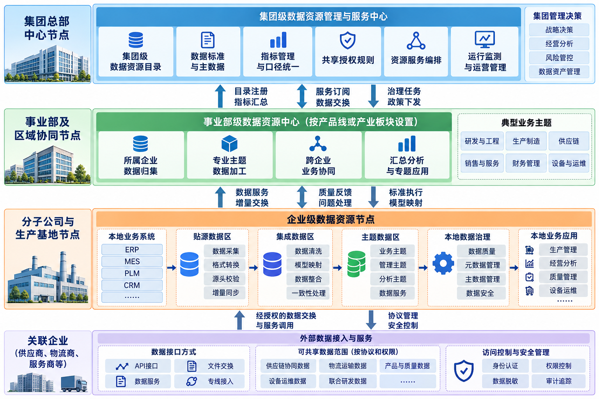
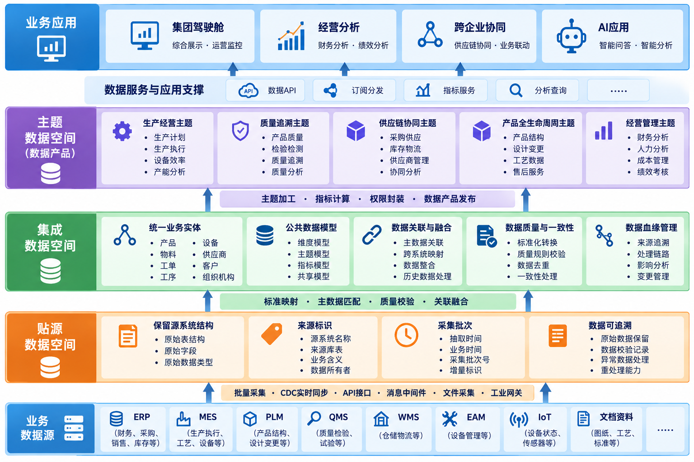
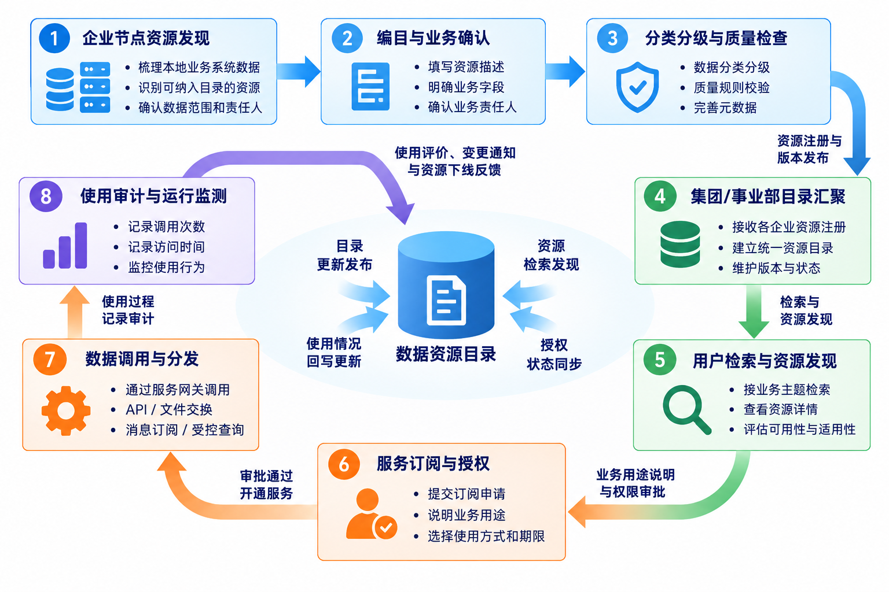
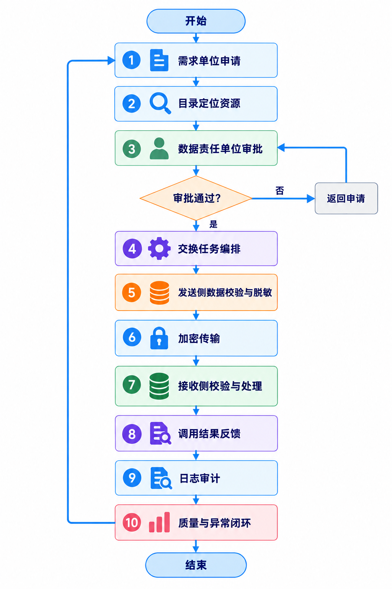
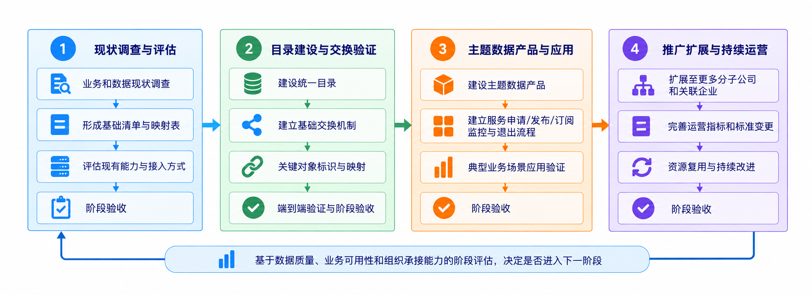

# 第16章 数据资源体系建设实践

本章以某大型轨道交通装备制造集团为背景，结合集团总部、事业部、分子公司、生产基地及关联企业构成的多层级管理环境，介绍数据资源体系在总体架构、资源目录、共享交换、数据治理和运营管理等方面的设计方法与工程实践。

数据资源体系以分级节点为组织基础，通过贴源、集成和主题数据空间完成数据组织与加工，并以资源目录、共享交换和专题服务支撑数据使用。在轨道交通装备制造业务中，这些能力需要与研发、采购、生产、质量、设备、营销和售后等环节衔接，同时明确集团与所属企业的数据管理职责及共享边界。

# 16.1 数据资源体系总体架构

## 16.1.1 建设背景与业务边界

大型装备制造集团的数据分布于不同组织层级和业务环节。集团总部需要掌握经营状况、产业布局、重大项目进度和关键风险；事业部负责产品线经营与资源协调；分子公司及生产基地运行 ERP、MES、PLM、QMS、WMS、EAM 等业务系统，持续产生订单、工艺、生产、检验、库存和设备运行数据。关联企业与外部合作伙伴在采购、配套制造、物流和售后服务过程中也存在数据协作需求。各层级关注的业务范围不同，数据产生位置、使用权限和更新周期也有所区别。

将全部数据集中到集团总部，容易增加采集和重复传输成本，也可能影响数据时效并模糊源头责任；完全由所属企业独立管理，则难以统一指标口径、核心主数据和跨企业资源发现机制。因此，总体设计采用“统一规则、分级节点、属地治理、按需汇聚、授权共享”的方式。集团统一管理规则、目录和共性能力，所属企业负责源头质量与本地资源管理，跨企业数据流转通过授权、审计和服务机制实现。

## 16.1.2 分级节点与组织协同

集团数据资源体系按照管理职责设置不同层级的节点。集团中心节点负责集团级资源目录、跨企业指标口径、数据标准发布、共享授权规则、资源服务编排和运行监测。事业部节点可按产品线或产业板块设置，承担所属企业数据归集、专业主题加工和跨企业业务协同。企业节点连接本地业务系统，负责贴源采集、源头质量校验、数据模型映射及本企业主题服务。规模较小、缺少独立建设条件的企业，可通过共享节点或托管节点接入，无须分别建设完整平台。

关联企业并不等同于集团内部单位。能否访问目录、调用服务或接收数据，应根据业务协议、数据分类分级、合同约束及相应授权关系确定。集团内部的数据权限管理与跨法人主体的数据共享需要分别划定边界，不能因为存在组织关联关系就默认开放数据。

图16-1 集团级数据资源体系分级节点架构

## 16.1.3 数据分层与技术架构

数据组织采用贴源、集成、主题三级数据空间。贴源数据空间保留业务源系统的原始结构、业务时间和来源标识，为数据追溯、重复处理和源头核对提供依据。集成数据空间通过编码映射、实体识别、主数据关联、标准转换和质量校验，将不同系统中描述同一业务对象的数据组织起来。主题数据空间面向订单履约、产品全生命周期、生产效率、供应链协同、质量追溯和经营分析等需求，形成可供应用调用的数据产品与服务。三级数据空间属于逻辑分层，并不意味着物理上必须部署三套独立数据库。

以某型号装备的生产履历为例，相关数据分别来自 PLM 中的产品结构与版本、ERP 中的物料和工单、MES 中的工序执行记录、QMS 中的检验记录以及设备系统中的运行参数。贴源层保留各系统的数据结构与业务语义，集成层建立产品、物料、工单、工序、设备和质量事件之间的关联，主题层在此基础上形成“产品生产质量追溯”数据产品。各层转换规则和数据血缘清楚，才能在指标出现差异或业务异常时追溯原因。

图16-2 数据资源分层与服务关系

分级节点不要求各单位采用完全相同的软硬件配置。集团中心侧主要承担目录索引、跨企业主题汇聚、统一服务入口和运行监测，所属企业侧则靠近业务系统配置采集、缓冲、数据加工和本地服务能力。生产现场持续产生的设备状态与工艺参数，还涉及工业网络边界和现场系统的接入控制，不能直接套用一般数据库抽取方式。现场数据进入企业节点后，可按设备、产线和时间窗口加工为事件或指标，再依据集团业务需求决定上送范围。

数据加工需要保留从来源到结果的可追溯关系。贴源层记录源系统、抽取时间、业务时间和采集批次；集成层保存主键映射、去重规则、标准转换和实体关联依据；主题层记录指标口径、统计周期、计算版本及适用组织范围。当经营驾驶舱中的指标出现异常波动时，既要检查计算任务，也要能够沿数据血缘追溯到相关业务记录。人工修订统计结果的，还应记录修订人、依据和生效范围，避免形成无法解释的调整。

## 16.1.4 架构实施的关键约束

分级架构需要兼顾统一性与自治性。集团统一资源标识、数据分类、目录元数据、核心编码和接口规范，但不宜将全部业务字段强行纳入单一模型。生产工艺、检验标准和设备参数具有产品线差异，可通过公共模型与专业扩展模型共同管理。设备时序数据以及大体量图像、视频资料，宜在产生地点预处理并就近存储，由集团按需获取指标、摘要、特征或授权明细，减少不必要的数据传输。

技术实现应兼容现有基础设施。关系型数据库、湖仓平台、消息中间件、对象存储和数据服务网关可以结合已有投资分阶段配置，不以采购某一种平台为前提。跨节点任务应具备失败重试、断点续传、版本管理、幂等处理、访问审计和异常告警能力。关键业务指标还须明确更新时限与对账机制，不能仅以接口联通作为建设完成的依据。

# 16.2 数据资源目录

## 16.2.1 目录的管理对象与分级组织

数据资源目录是资源发现、管理责任识别和服务申请的入口。目录登记资源的业务含义、管理属性、技术位置、更新规则及共享条件，并不负责集中存储全部数据。集团目录提供跨企业资源发现能力，事业部目录组织专业业务域资源，企业目录管理本地数据资产和源系统资源。各级目录通过统一标识与注册机制，形成逻辑上的集团资源总目录。

目录的基本对象宜区分数据集、数据表、文件资源、指标、接口服务和主题数据产品。每类对象具有不同的技术属性，但应共享资源名称、业务定义、所属数据域、责任单位、责任人、分类分级、更新时间、质量状态、授权方式及生命周期状态等基础元数据。一个主题数据产品可能由多张表和多个接口组成，目录中应记录其依赖关系，避免把物理表数量直接当作可用数据产品数量。

| **目录层级** | **主要责任** | **典型资源** |
|:--:|----|----|
| 集团总目录 | 统一编码、跨企业发现、共享审批 | 集团经营指标、跨企业主数据、公共主题产品 |
| 事业部目录 | 专业分类、口径协调、主题汇总 | 产品线质量、产能、交付协同数据 |
| 企业目录 | 源头登记、技术映射、质量维护 | 工单、检验、设备、库存、工艺数据 |
| 合作方目录接口 | 受控发布、合同范围内使用 | 供应商交付、物流状态、售后协同服务 |

## 16.2.2 目录编制与资源注册

编制数据资源目录，首先需要确定数据域和业务对象分类。通常可从组织、客户、供应商、产品、物料、订单、合同、生产、设备、质量、财务和服务等相对稳定的业务对象入手，结合集团既有编码体系建立多级分类。产品结构、工艺路线和设备采集数据等专业资源，可由事业部在公共分类下按业务需要扩展。分类体系应保持相对稳定，具体资源则可持续增减，避免因频繁调整分类而影响历史目录的对照与使用。

资源注册应由数据责任单位发起，经业务定义核实、技术信息采集、分类分级审查、质量检查和目录发布后进入可发现状态。资源变更时，系统应记录版本号、变更原因和影响范围；资源停用时，保留历史目录与调用关系，通知订阅方完成迁移。自动采集可以提高表结构、字段和血缘信息的完整性，但业务含义、使用限制和管理责任仍需要人工确认。

目录条目的稳定性依赖资源标识与版本管理。资源编码不宜直接使用数据库实例名、表名或所属部门名称，因为系统迁移和组织调整会使这些信息发生变化。可以将资源唯一标识与业务分类、责任主体、技术位置分开管理；技术地址变更时保留资源身份，业务定义发生实质变化时则通过新版本或新资源登记体现。对于已发布的共享接口，版本调整应说明字段增删、取值范围变化、兼容期限和下游订阅单位，避免目录仍可检索而接口已经无法使用。

资源目录还应区分“资源存在”和“资源可共享”。部分数据虽然已经登记，但受到商业秘密、个人信息、合同约束或生产安全要求限制，只能展示必要的描述信息；部分资源可在集团内部共享，却不适合向关联企业提供明细。目录中应分别维护可见范围、申请条件、授权审批主体和可交付形式。对无法提供原始数据的资源，可登记受控查询、脱敏结果或统计服务，使资源发现机制与实际管理边界保持一致。

## 16.2.3 目录与服务的联动

目录可发现并不等于数据可访问。使用单位检索到资源后，应说明业务用途并提出订阅申请，由相关责任主体结合申请人身份、所属组织、数据等级、使用场景和授权期限进行审批。审批通过后，服务网关才开放 API、文件交换、消息订阅或受控查询入口。目录还应关联服务调用次数、最近访问时间、质量评分及授权状态，使资源管理从静态登记延伸至使用过程。

图16-3 数据资源目录发布与订阅闭环

# 16.3 数据共享交换

## 16.3.1 共享模式选择

集团内部共享交换需要根据业务时效、数据规模和安全边界选择方式。经营报表及历史明细适合定时批量汇聚；订单状态、库存变更和质量事件可通过 CDC 或消息事件同步；实时校验和按需访问可采用 API 服务。大规模工业时序数据宜在边缘侧预处理后分级汇聚；跨法人主体的敏感数据，应优先提供最小必要字段、授权接口或经适当处理的数据产品。多种交换方式可以并存，但需要纳入统一目录、任务管理和审计机制。

|     **业务场景**     | **建议方式**          | **关键控制点**                 |
|:--------------------:|-----------------------|--------------------------------|
|   集团经营指标汇总   | 定时批量/指标服务     | 统一口径、统计周期、对账       |
| 跨企业订单与交付协同 | API/消息订阅          | 业务主键、事件顺序、幂等       |
|     产品质量追溯     | 按需查询/主题数据分发 | 版本追溯、授权范围             |
|     设备运行状态     | 边缘汇聚/流式处理     | 采样频率、时钟同步、网络负载   |
|     关联企业协同     | 受控接口/授权数据产品 | 协议约束、脱敏、审计与到期回收 |

## 16.3.2 跨节点交换流程

跨节点交换包括资源发布、需求申请、授权校验、任务编排、数据传输、接收校验和结果反馈。发送节点完成字段映射、敏感信息处理及完整性检查；传输通道实施身份认证和加密保护；接收节点核对记录数量、校验值、业务主键和版本信息，并将处理结果反馈至任务中心。增量同步任务还需保存检查点和重试状态，防止网络中断造成数据遗漏或重复入库。

集团总部不必承担全部跨企业明细数据的中转任务。事业部内部企业之间的协同，可在集团统一授权和审计规则下采用节点直连，也可通过区域协同节点转发；需要开展集团级分析的数据，再按最小必要原则汇聚至集团节点。这种安排有助于降低中心网络压力，减少不必要的跨组织数据复制。

图16-4 跨节点共享交换业务流程

交换任务应在设计阶段明确数据交付约定，包括资源标识、数据结构、字段含义、主键规则、更新频率、传输方式、允许延迟及异常处理要求。增量交换必须明确变化捕获依据，可以使用数据库日志、业务更新时间或业务事件，但在未验证源系统更新机制前，不宜仅依赖时间戳。接收端应具备幂等处理能力，通过业务键、批次号或事件标识识别重复数据，并制定迟到数据、撤销及冲正记录的处理规则。

跨节点对账不仅核查记录数量和校验值，还要确认业务状态是否一致。例如，采购订单发生部分收货、退货或关闭时，目标端不能仅以最新状态覆盖全部历史记录。交换平台应根据资源类型选择快照、增量事件或历史版本的保留策略。任务失败后，还需区分网络故障、数据格式不符、授权失效和业务校验失败，分别执行自动重试或人工处置。

## 16.3.3 安全与运行保障

共享交换的安全控制应贯穿资源登记、申请审批、传输处理和使用审计全过程。至少需要实现统一身份认证、组织级和资源级权限控制、敏感字段脱敏、传输加密、访问日志、授权到期回收及异常访问告警。对于跨法人主体的数据流转，还应明确数据提供方、使用方的权利义务和用途限制，避免把技术可达性等同于合法可用性。

运行管理需要监测任务成功率、端到端延迟、数据完整率、服务可用性和异常恢复时间。接口返回成功仅说明传输环节完成，并不能证明业务数据正确。对于库存、订单和质量事件等关键数据，应建立源端与目标端的业务对账规则。数据撤回、修订或源系统重算时，还需要通知下游使用方，并按影响范围开展相应处理。

# 16.4 数据资源治理

## 16.4.1 从贴源到主题的数据治理路径

数据治理不能等同于采集后的一次性清洗。制造集团的数据治理贯穿源头录入、贴源校验、跨系统集成、主题加工和服务使用。源头治理关注编码规范、必填约束与业务流程控制；贴源治理检查采集完整性、格式有效性和来源可追溯性；集成治理处理实体匹配、标准映射、跨系统一致性及重复记录；主题治理则核查指标定义、业务口径、计算规则和结果解释。

以供应链交付分析为例，ERP 中的采购订单、供应商系统中的承诺交期、物流系统中的在途状态以及仓储系统中的实际收货记录，先统一供应商、物料、采购订单和交货批次标识，然后处理日期口径、单位换算和状态映射，再形成准时交付率、缺料风险和库存周转等主题指标。任何一个环节出现定义差异，最终结果都可能失真。

## 16.4.2 主数据与公共数据模型

集团应优先统一跨企业共享频繁、业务影响较大的主数据对象，包括组织机构、法人主体、客户、供应商、物料、产品、设备分类和地理位置等。统一不等于要求所有企业采用完全相同的业务编码，实际可采用集团全局标识与企业本地标识映射的方式，在保留既有系统连续性的同时建立跨企业关联。对于物料和产品的不同版本、替代关系及有效期，需要建立明确的变更和历史追溯机制。

公共数据模型应围绕稳定的业务实体和关系建立，而不是从某个应用系统的表结构直接复制。集团级模型负责定义通用业务对象、关键属性和关系，事业部扩展专业属性，企业节点维护源系统映射。对于产品全生命周期，可建立产品—型号—配置—零部件—工艺—工单—检验—交付—服务事件的关联链条，并通过元数据管理记录模型版本与字段血缘。

集团公共模型建设需要控制统一范围。以物料为例，集团统一标识可以解决跨企业统计和供应协同问题，但不同制造企业可能采用不同的计量单位、替代料规则和物料有效期管理方式。公共模型应定义必须统一的识别属性及其映射关系，专业属性则在企业模型中保留。数据集成时通过映射表和生效时间连接两类模型，既避免跨企业数据无法汇总，也避免以统一名义修改现有生产系统中已经稳定运行的业务规则。

## 16.4.3 质量规则与问题闭环

质量规则应按业务重要程度分级管理。基础规则包括完整性、唯一性、合法性、及时性和一致性；业务规则则涉及订单状态闭环、工序执行顺序、物料批次追溯、检验结论与放行状态对应等。集团统一制定公共规则模板，企业根据业务流程补充专业规则，避免出现集团规则无法适配现场生产的情况。

问题闭环应明确发现、分派、核实、整改、复检和归档责任。对于源系统错误，原则上由数据产生单位在源头修正，集成平台只承担必要的隔离、标记和补偿处理；对于标准口径冲突，应提交跨部门数据治理机制协调。数据质量考核既应关注规则通过率，也应关注问题重复发生率、整改周期和对业务结果的实际影响。

| **治理对象** | **典型问题**                 | **治理责任与方法**            |
|:------------:|------------------------------|-------------------------------|
|  组织/法人   | 不同系统名称及编码不一致     | 集团主数据管理，企业维护映射  |
|  物料/产品   | 多版本、重复编码、单位不一致 | 统一标识、版本与有效期管理    |
|   生产工单   | 状态延迟、跨系统关联缺失     | MES/ERP责任部门核对、增量补偿 |
|   质量检验   | 检验批次和产品序列号断链     | QMS规则校验、链路追溯         |
|   经营指标   | 统计周期与口径不一致         | 指标责任人审批、口径版本管理  |

质量规则上线前应形成可执行的验证样本。规则制定人员可以从真实业务记录中选择正常、缺失、重复、跨期和状态冲突等典型情况，明确每种情况的预期处理结果，再由平台实现检查逻辑。对关键经营指标，还需要建立与业务系统报表的核对机制，并记录差异是否来自统计时间、组织范围、数据延迟或计算公式。规则通过率不能替代业务验收，尤其不能以自动修正后的结果掩盖源系统长期存在的问题。

## 16.4.4 元数据与安全治理

元数据管理应覆盖业务元数据、技术元数据和运行元数据。业务元数据描述资源含义、管理责任和使用范围；技术元数据描述表、字段、接口、任务与模型关系；运行元数据记录更新时间、任务状态、质量检查和服务使用情况。通过统一元数据标识建立从源系统字段到主题指标的血缘链条，可以支持指标解释、问题定位和变更影响分析。

数据安全与治理活动应同步设计。目录编制时完成分类分级，数据集成时执行字段级访问控制与脱敏，主题发布时核对用途和共享范围，服务运行时保留可追溯审计记录。对于工艺参数、供应商价格、客户合同等商业敏感数据，需要根据业务需要限定访问主体与使用方式；涉及个人信息的，应按照适用法律法规落实处理依据、最小必要、保留期限和安全措施。

# 16.5 数据资源运营

## 16.5.1 运营组织与职责

数据资源体系建成后，目录、模型、质量规则和共享服务会持续变化，因此必须建立常态化运营机制。集团数据管理部门负责统一标准、资源运营规则、跨企业争议协调和总体绩效评估；事业部数据团队负责专业主题管理、指标口径协调和跨企业服务需求；企业数据管理员负责本地资源登记、质量整改、变更通知和日常服务保障；业务部门则承担业务定义确认和使用效果评价。

运营组织需要业务数据责任人、数据管理员和技术运维人员共同参与。数据责任人确认资源的业务定义、共享边界和质量要求；数据管理员维护目录、规则及问题工单；技术人员保障采集任务、接口服务和平台运行。三类岗位职责不同，不宜将全部数据问题交由信息技术部门处理。

## 16.5.2 资源运营流程

资源运营从需求收集开始。业务部门提出新的指标、数据集或共享需求后，运营团队先检索已有目录，判断是否能够复用现有资源；确需新增时，再开展资源建模、责任确认、采集治理、服务封装、测试发布和订阅管理。资源发布以后持续跟踪调用情况、质量状态、使用反馈和维护成本，对长期无人使用或已失效资源执行下线评审，避免资源目录不断膨胀而实际可用性下降。

对于集团经营驾驶舱等关键应用，应将数据服务运营与业务运营联系起来。例如，某指标长期出现数据延迟，运营人员不仅需要检查同步任务，还应识别是否影响经营例会和业务决策；某质量追溯服务调用量持续增长，应结合系统负载与查询模式优化缓存、索引或计算方式。运营指标最终应反映数据服务对业务的支持效果，而不仅是平台的技术运行状态。

资源服务的变更应当纳入日常运营，而不只是平台升级时集中处理。资源责任单位提出字段、口径或更新周期调整后，运营人员先查询目录中的订阅关系和数据血缘，识别受影响的主题数据、接口及业务应用；随后确定兼容方案、测试范围和切换时间，并通知使用单位。对于集团经营报表等关键应用，可在一段时期内并行计算新旧口径，通过差异分析确认切换条件。资源停用时也应检查是否存在长期未记录但实际仍在使用的离线导出或人工报送链路。

## 16.5.3 运营评价与持续改进

数据资源运营的评价机制仍在不断完善。相比平台建设和数据治理，资源投入使用后的持续维护、共享效率与业务成效往往缺少统一的衡量口径。因此，运营评价应从体系设计阶段同步考虑，先明确资源覆盖、质量、共享、使用和运行保障等基本维度，再结合实际应用逐步完善指标及其统计规则。

| **评价维度** | **建议指标** | **管理目的** |
|:--:|----|----|
| 资源覆盖 | 关键业务域编目覆盖率、责任人明确率 | 判断资源是否可发现、可管理 |
| 资源质量 | 关键规则通过率、问题整改周期 | 衡量数据可信程度 |
| 共享效率 | 申请处理时长、接口成功率、数据交付及时率 | 衡量跨组织协同能力 |
| 资源使用 | 有效订阅数、活跃资源占比、复用次数 | 识别真正被使用的资源 |
| 运行保障 | 任务恢复时长、异常闭环率、服务可用性 | 保障持续运行 |

评价指标应与建设阶段相匹配。初期重点关注资源盘点、目录覆盖和基础质量；随着跨企业共享展开，逐步关注主题服务复用和共享效率；进入稳定运营阶段后，再评价业务效率、风险控制及数据产品使用成效。难以直接量化的业务收益，应保留应用场景、使用主体、基线状态和改进结果等证据，不宜将接口调用次数直接折算为经济效益。

# 16.6 典型建设案例：集团级生产经营与质量协同

## 16.6.1 案例背景与目标

某大型轨道交通装备制造集团的业务覆盖产品研发、物料采购、生产制造、质量检验和交付服务等环节。集团总部需要掌握所属企业的订单执行、产能利用、关键物料保障、产品质量和交付风险；生产企业依托 ERP、MES、PLM、QMS、WMS 等系统开展日常管理。由于各系统建设时期、数据标准和管理口径存在差异，跨企业经营分析与生产协同面临数据来源分散、对象编码不统一和业务指标难以关联等问题。

经营驾驶舱是数据资源体系的重要应用之一。它需要将不同业务系统中的经营指标、生产进度和质量信息按照统一口径组织起来，并能够追溯指标来源。进一步开展供应链协同和产品质量追溯时，还要关联采购订单、物料批次、生产工单、工序执行与检验记录。这些需求决定了数据资源体系不能停留在报表汇总层面，而必须建立可复用的数据资源组织和共享机制。

## 16.6.2 需求拆解与资源清单

围绕业务目标，需求主要涉及三个场景。集团经营分析需要统一订单金额、交付进度、产值、库存和成本等指标，解决统计口径及更新周期差异；供应链协同需要关联采购订单、供应商交付承诺、在途物流、到货验收和生产缺料信息，解决跨系统业务主键关联与数据时效问题；质量追溯则需要连接产品结构、生产工序、关键零部件批次、检验记录和售后问题，重点处理版本管理及追溯链条完整性。

| **业务域** | **主要来源系统** | **关键数据资源** | **主要使用方** |
|----|----|----|----|
| 经营管理 | ERP、财务系统 | 订单、收入、成本、库存、产值 | 集团经营分析 |
| 研发工艺 | PLM、工艺系统 | 产品BOM、版本、工艺路线 | 研发、制造、质量 |
| 生产执行 | MES、设备系统 | 工单、工序、报工、设备状态 | 工厂、事业部 |
| 质量管理 | QMS、检验系统 | 检验批次、缺陷、不合格处置 | 质量部门、售后 |
| 供应链 | SRM、WMS、物流接口 | 采购、交期、到货、库存 | 采购、生产计划 |
| 售后服务 | CRM、服务系统 | 交付设备、维修、故障、备件 | 服务部门、质量部门 |

资源盘点不能只统计系统数量。对于每一项关键业务需求，应将所需数据逐项落实到产生系统、业务责任部门、获取方式、更新周期和使用限制。例如，订单交付分析至少涉及订单主档、计划交期、实际生产进度、出库发运和客户验收等记录，部分数据可能存在于不同法人主体。盘点时应检查业务标识是否能够关联，以及订单拆分、合并、变更和取消如何反映在数据中。对于暂时无法稳定获取的数据，应在需求分析阶段标记缺口，不能在主题设计时默认其已经具备。

## 16.6.3 总体建设方案

集团总部配置统一资源目录、指标管理、共享交换控制和集团级主题服务能力；主要事业部设置专业协同节点，负责产品线公共模型、质量主题和供应链专题加工；分子公司通过企业数据节点或托管方式接入，完成本地系统采集、贴源数据保存、数据校验及专业服务。核心主数据和指标口径由集团统一管理，所属企业继续承担专业数据管理责任。对于不需要汇聚原始明细的业务，集团优先订阅经企业确认的指标或主题服务。

工程实施宜从可验证的业务链路入手，例如“采购订单—到货—生产领料—工单执行—质量检验—产品交付”。先梳理链路涉及的数据源，建立实体标识映射和跨系统数据血缘，再形成集团级交付进度与质量风险主题。待数据质量和服务机制稳定后，逐步扩展到设备运维、产品全生命周期和售后质量分析。相比一次性采集全部业务数据，这一路径更便于控制建设范围、验证应用效果，并积累可复用的数据模型。

| 业务链路｜采购订单 → 到货入库 → 生产执行 → 质量检验 → 产品交付 |
|----------------------------------------------------------------|
| 源系统｜ERP / SRM → WMS → MES / PLM → QMS → CRM                |
| 数据组织｜贴源采集 → 主数据关联与集成模型 → 交付/质量主题数据  |
| 资源发布｜企业目录注册 → 集团目录汇聚 → 服务授权与订阅         |
| 业务使用｜集团驾驶舱 · 交付风险预警 · 质量追溯 · 供应链协同    |

图16-5 制造集团业务链路与数据资源建设映射

在实施顺序上，可以先围绕一条业务链路完成从源端到服务端的闭环，再逐步扩大到其他企业和主题。以关键零部件质量追溯为例，先确定产品、零部件、供应商、采购批次、生产工单和检验记录的关联规则，接入相关系统形成贴源数据，再通过公共标识和映射规则生成集成数据。主题层按照产品、批次和质量事件组织查询视图，对外提供追溯检索及必要的统计服务。业务人员能够从一条质量问题记录追查到相关批次、工序和供应来源，才说明这条数据链路具备实际使用价值。

集团节点与企业节点之间的共享范围应随应用场景确定。集团经营驾驶舱主要需要统一口径的指标及必要的核查明细，质量协同则可能需要跨企业的批次与检验关联信息，设备运行分析往往只需异常事件、健康指标或按需查询。三类业务不应采用同一套全量汇聚策略。对关联企业参与的数据协同，还需要通过合同或业务协议明确数据提供责任、允许用途、保留期限和退出后的处置方式，并将这些要求落实到接口授权和审计记录中。

## 16.6.4 分阶段实施与验证

集团级数据资源体系涉及多个管理层级和业务系统，实施时应根据基础条件与业务依赖划分阶段。建设工作可分为现状调查与评估、目录建设与交换验证、主题数据产品应用、推广扩展与持续运营四个阶段。各阶段均设置明确的交付成果和验收要求，验证通过后再扩大建设范围。

第一阶段开展业务与数据现状调查，形成组织节点、业务系统和数据资源清单，以及跨系统实体映射表、关键指标口径表。已具备数据平台的企业优先复用现有采集、存储和计算能力；基础较弱的企业可采用轻量级接入代理或共享节点接入集团体系。阶段验收重点核查责任边界、关键数据定位情况和既有资源的复用条件。

第二阶段建设统一目录和基础交换机制，完成组织、供应商、物料、产品等关键对象的全局标识或映射，并选取核心指标建立端到端验证链路。验证内容不仅包括数据传输，还应检查业务口径一致性、质量问题定位、授权有效性、断链恢复和历史版本追溯能力。

第三阶段围绕经营驾驶舱、供应链交付和质量追溯形成主题数据产品，建立数据服务申请、发布、订阅、监控和退出流程。第四阶段将成熟的资源与服务机制扩展至更多分子公司和关联企业，完善运营指标、标准变更、资源复用及持续改进机制。是否进入下一阶段，应依据数据质量、业务可用性和组织承接能力判断，而不能仅以计划时间作为依据。

阶段验收应围绕具体业务链路设置检查项。基础阶段核查目录与实际数据源的一致性、公共标识映射的正确性及采集任务恢复能力；主题阶段检查指标口径、数据血缘、历史追溯和跨企业对账；应用阶段由业务部门使用典型订单、生产批次或质量事件进行验证，确认结果能否满足管理需要。发现差异后，应区分数据缺失、规则错误和业务定义争议，形成问题清单并完成复检，再推广至下一批企业。

## 16.6.5 关键设计取舍与风险

首先是集中与分布的取舍。集团需要统一发现和治理规则，但并不需要复制全部企业原始数据。对于敏感、高频和大体量工业数据，采用属地保留与按需服务更为合适；对于集团经营分析和跨企业协同必需的数据，再建立标准化汇聚机制。其次是统一模型与业务差异的取舍。核心主数据和公共指标应统一，专业工艺和产品线特有属性则保留扩展空间，以免过度标准化影响现场业务。

再次是技术平台与管理机制的取舍。平台能够完成采集、处理和服务，但跨企业数据责任、共享审批和指标争议需要明确的组织协调机制。最后是建设范围与落地速度的取舍。应优先选择有明确业务责任人、源数据可获得、效果可验证的业务链路开展试点，并把形成的数据标准、模型、接口规范和质量规则沉淀为可复用资产，再逐步推广。

集团级数据资源体系建设的重点，并非在总部建立规模更大的数据平台，而是按照统一规则，将不同组织和系统中的数据组织为可发现、可治理、可共享、可运营的资源。贴源、集成和主题三级数据空间构成数据加工与组织路径，分级节点明确管理和部署责任，资源目录及共享交换连接数据供需双方，治理与运营机制则保证体系能够随业务变化持续运行。
