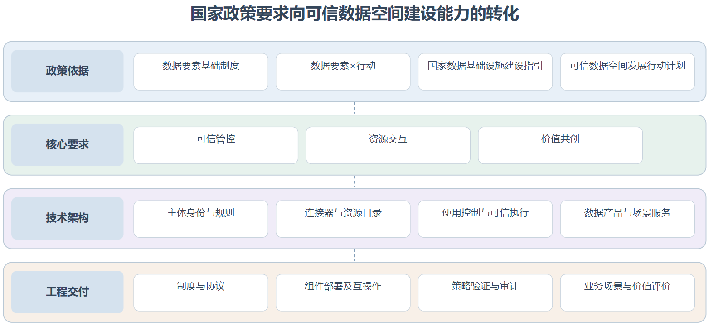
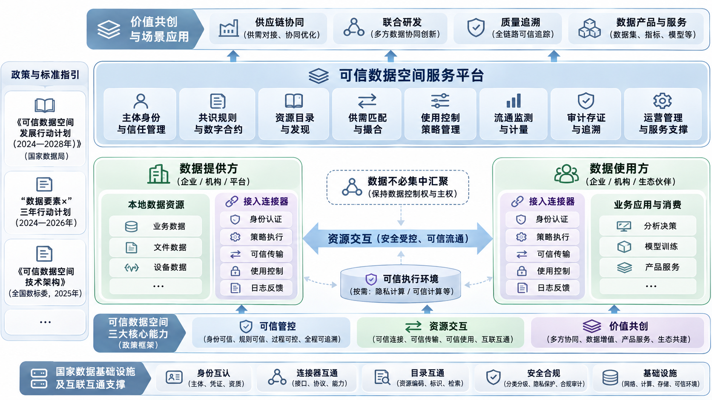
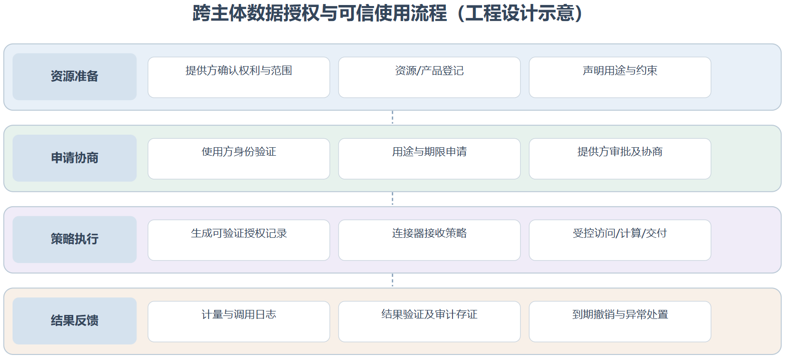
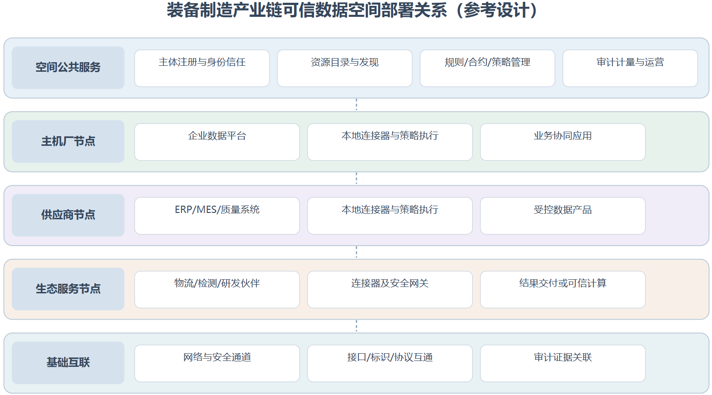
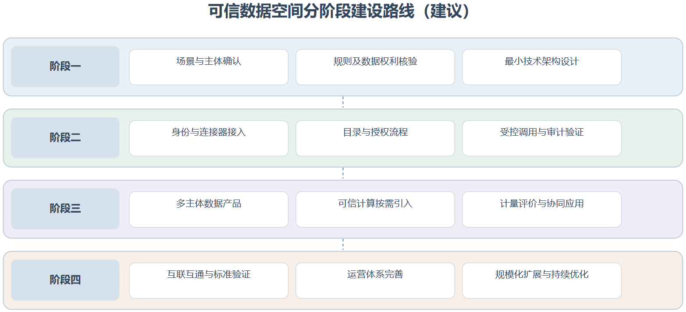

# 第17章 可信数据空间与数据要素流通

可信数据空间建设具有鲜明的国家政策与数据基础设施背景。本章从国家数据要素制度与可信数据空间发展行动计划出发，说明可信管控、资源交互、价值共创三类核心能力如何转化为技术架构、工程组件、授权使用机制和产业协作场景。与第15章企业数据平台建设、第16章数据资源体系建设不同，本章关注独立主体之间基于共识规则的可信数据流通与价值协同。

本章采用“政策与顶层设计—业务与数据产品—总体技术架构—可信授权与使用—运营与价值共创—企业工程实践”的逻辑组织，配套政策映射、总体架构、授权流程、部署关系和建设路线五张图。

## 17.1 国家政策、顶层设计与可信数据空间定位

### 17.1.1 从数据要素制度建设到可信数据空间

可信数据空间在我国不是由某个软件产品或单一技术路线定义的市场概念，而是国家数据要素市场化配置改革和国家数据基础设施建设的重要实践方向。理解其技术架构，首先应当区分三个层次：数据要素基础制度回答数据权利、流通交易、收益分配和安全治理的制度问题；国家数据基础设施建设回答跨主体、跨区域、跨行业的数据如何形成互联互通和安全流通能力；可信数据空间则在多主体共识规则基础上，将可信管控、资源交互和价值共创落实为可建设、可运营的协作环境。三个层次之间具有政策目标与工程实现的关联，但不能将政策目标直接等同于某项具体技术的强制采购要求。

国家数据局印发的《可信数据空间发展行动计划（2024—2028年）》（国数资源〔2024〕119号）明确将可信数据空间界定为基于共识规则、联接多方主体、实现数据资源共享共用的数据流通利用基础设施，同时也是数据要素价值共创的应用生态。该文件提出企业、行业、城市、个人和跨境五类可信数据空间的发展方向，并以可信管控、资源交互、价值共创作为三类核心能力。其目标不是建设一个统一集中存储所有数据的数据库，而是通过规则、连接与协作促进数据的合规高效流通利用。〔政策来源：国家数据局，2024年11月，见本章参考文献[1]〕

《国家数据基础设施建设指引》（发改数据〔2024〕1853号）由国家发展改革委、国家数据局、工业和信息化部联合印发，从数据流通利用、算力底座、网络支撑和安全防护等方面提出国家数据基础设施建设方向。可信数据空间需要放在这一基础设施体系中理解，而不能孤立地被解释为企业内部数据交换中台。对企业项目而言，这意味着方案应考虑身份、标识、连接、目录、安全和互操作等公共能力，同时处理好企业既有数据平台、跨组织协作环境和外部基础设施之间的接口。〔政策来源：国家数据局，2025年1月，见[2]〕

2025年4月30日，全国数据标准化技术委员会在国家数据局指导下发布《可信数据空间 技术架构》技术文件，明确其定位、核心技术特征、最小功能集合和关键业务流程，并说明可用于指导地方、行业、领域和企业的规划、建设、运营和管理。这一文件是从政策目标走向技术方案的重要桥梁。需要注意，技术文件与法律法规、强制性标准并非同一效力层级；本章把它作为架构设计的重要参考，不将书中选择的具体组件实现冒称为国家强制规定。〔技术文件来源：全国数标委，2025年4月，见[3]〕

### 17.1.2 政策文件与工程设计的对应关系

*图17-1 国家政策要求到工程能力映射*

国家政策要求必须进一步转化为可检查的工程任务。可信管控要求建设主体身份与信任、规则表达、授权策略、使用约束和可追溯证据等能力；资源交互要求建设连接器、目录、标识、协议适配、受控传输和互操作能力；价值共创则要求面向共同业务场景组织数据产品、联合计算、服务协同和效果评价。三类能力相互依赖，不能只建设目录和数据交换接口便宣称完整具备可信数据空间能力，也不能把隐私计算部署数量当作价值共创成果。

| 政策与技术依据 | 直接涉及的建设方向 | 本章工程落点 |
|---|---|---|
| 《可信数据空间发展行动计划（2024—2028年）》 | 可信管控、资源交互、价值共创；五类空间发展 | 17.3总体架构、17.4授权控制、17.5运营价值 |
| 《国家数据基础设施建设指引》 | 数据流通利用、算力底座、网络支撑、安全防护 | 17.3基础互联与部署接口、17.6工程实施 |
| 《可信数据空间 技术架构》 | 核心技术特征、最小功能集合、关键业务流程 | 17.3组件边界、17.4关键流程 |
| 《可信数据空间标准化研究报告（2025版）》 | 基础通用、功能技术、业务运营、安全保障、能力评价、应用服务等标准化方向 | 17.6互操作验证与能力评价 |

表中的工程落点是本书根据文件目标形成的建设分析，并非逐条照录的规范性条款。具体项目还需根据适用标准的现行版本、试点要求和采购文件确定验收依据。

### 17.1.3 五类可信数据空间与企业建设定位

《行动计划》提出企业、行业、城市、个人和跨境五类可信数据空间。五类空间并非五种互不兼容的技术产品，而是按照建设主体、参与关系和应用范围形成的不同发展方向。企业可信数据空间更强调龙头企业或集团围绕产业链上下游形成协作；行业可信数据空间强调行业共性需求、资源互通和多主体服务；城市可信数据空间侧重城市范围的数据协同；个人可信数据空间关注个人数据的可信管理与授权使用；跨境可信数据空间则涉及更复杂的跨境合规和协作要求。

对于本书贯穿的装备制造集团场景，应首先识别其项目究竟是集团内部的数据资源共享体系，还是与独立供应商、物流商、检测机构、研发伙伴建立基于共识规则的跨主体协作环境。仅在集团内部部署统一数据平台和数据目录，不能自动称为可信数据空间；只有在参与主体、规则机制、资源交互、可信使用和价值场景等方面形成相应能力，才具备讨论可信数据空间建设的实际基础。

### 17.1.4 规范性要求、参考架构与工程选型的界限

政策文件、技术文件和企业工程方案应当分别表达。政策文件明确方向与目标，技术架构文件提供功能与流程参考，工程方案再根据数据敏感性、参与主体、网络条件和成本约束选择技术实现。例如，使用控制可以通过连接器策略执行、服务网关、受控查询或可信计算环境等方式组合实现；隐私计算和可信执行环境是某些场景的可选能力，而不是任何可信数据空间都必须部署的统一技术前提。所谓“数据不必集中汇聚”也不等于“任何数据都不得复制”，具体交付方式应服从授权、合规和业务需求。

本章后续各图均属于面向企业建设实践的参考设计图，不是国家标准原图。涉及数字合约、连接器策略执行、计量审计和联合计算的流程，需在具体项目中与采用的技术文件、产品实现及法律协议逐项核对。对尚未确认的标准条款、强制要求和安全保证，本章不作超出依据的承诺。

## 17.2 数据要素流通的业务基础与建设边界

### 17.2.1 从内部数据共享到跨主体数据协作

企业内部数据共享通常可以依托统一的组织管理、身份体系和信息化建设责任实现，即使不同部门之间存在数据壁垒，仍有可能通过集团制度、统一平台和内部授权加以协调。跨主体数据流通的约束更加复杂。数据提供方与使用方可能属于不同法人，存在不同的商业利益、技术环境、合规责任和风险偏好；数据的产生、加工、存储、使用和再分发也可能由不同主体承担。某一方允许对方查询一项指标，并不意味着允许其下载原始明细，更不意味着允许将数据转交第三方或用于模型训练。

因此，跨主体流通的设计起点应当是业务协作需求，而不是先建设一个能够上传和下载文件的平台。以装备制造产业链为例，主机厂希望掌握关键零部件交付状态，供应商希望减少重复报送，物流企业希望提高运输计划准确性，各方可以围绕交付协同形成共同的数据产品。但供应商的完整生产成本、其他客户订单和工艺细节未必属于该协作场景所需数据。可信数据空间需要把这种业务范围和权利边界转化为可执行的规则，使参与各方能够在可控条件下提供和使用数据。

### 17.2.2 数据流通与数据交易的区别

数据流通是数据在不同主体之间依据特定规则实现提供、访问、处理、共享或协同使用的过程，既包括有偿交易，也包括基于合同、公共服务、产业协同和业务合作的非交易性流通。数据交易通常更强调可计价的标的、交易规则、交付确认和结算关系。不能把建设可信数据空间直接等同于建设数据交易所，也不能把每次数据调用都理解为一次交易。许多产业数据空间的首要价值来自供应链效率、跨企业质量追溯和联合分析，而不是数据产品直接销售收入。

从工程视角看，数据流通至少涉及四个对象：提供数据或服务的主体、使用数据或结果的主体、负责建立协作规则与公共服务的运营主体，以及承担身份、连接、计算、审计等能力的技术服务主体。这些角色可以由不同组织承担，也可能在具体项目中部分重合。架构设计必须明确各角色的权利、义务和责任，不能因为某家单位建设了平台，就默认其有权取得和再利用所有接入的数据。

### 17.2.3 数据权利、合规与使用边界

数据流通涉及数据来源合法性、个人信息保护、商业秘密、重要数据、合同约定和行业监管等多种约束。项目应首先识别数据类别、处理目的、参与主体、跨境或跨域情况、必要性及适用规则，再选择相应的流通方式。对个人信息，应按照适用法律确认处理依据、告知与同意或其他合法性基础，并落实最小必要、目的限制和安全保护；对商业秘密和敏感工业数据，应通过合同、授权范围、访问控制和审计保护权益；对有特定监管要求的数据，应依据实际适用制度处理，不能仅凭技术加密就推定可以流通。

可信数据空间能够提供规则表达、技术执行和证据留存，但不能替代法律关系的确认。所谓“数据所有权”“数据使用权”等表述，在不同政策、合同和法律语境中具有不同含义，不能把某一技术平台登记的权限直接解释为普遍成立的法定产权。工程文件应当使用可核验的表达，例如数据提供资格、合同授权范围、允许的处理目的、访问期限、结果使用条件和违约责任。

### 17.2.4 典型流通模式与场景选择

常见流通模式包括受控API访问、文件或数据集交付、跨主体联合查询、受控计算、隐私保护联合分析和结果型数据产品交付。模式选择应取决于业务是否需要原始明细、是否允许数据离开原有控制域、计算是否可在提供方环境执行，以及使用方对时效、可验证性和成本的要求。对于无需暴露明细的供应商交付评分，优先考虑结果型指标服务；对于必须开展跨方明细核对的质量追溯，可以采用字段级授权、受控查询和审计；对于多方不能交换原始数据的统计分析，可评估隐私计算或可信执行环境，但需验证其计算能力、性能和安全假设。

场景遴选不宜只看参与主体数量和数据规模，更应评价共同收益、数据可获得性、授权复杂度、现有系统基础、协作意愿和持续运营成本。能够在少量主体之间完成真实的授权、调用、结果验证和责任闭环，比在项目初期接入大量缺乏使用场景的数据资源更有价值。

## 17.3 数据产品与流通服务设计

### 17.3.1 数据资源、数据集与数据产品

数据资源是组织在业务活动中形成或合法取得、能够被管理和利用的数据集合；数据集通常强调具有确定结构、范围和版本的数据对象；数据产品则进一步面向特定使用需求，对数据内容、服务接口、质量承诺、使用条件和责任关系进行封装。数据产品可以表现为可交付的数据集、指标API、查询服务、联合分析结果或面向业务决策的专题服务。并不是所有数据资源都需要商品化，也不是将数据库表登记到目录后就自然形成了数据产品。

可信数据空间中的数据产品必须能够回答使用方的实际问题，同时让提供方清楚掌握交付范围和使用风险。产品说明至少应包括提供主体、业务用途、数据范围、字段或结果定义、更新频率、时间覆盖、质量指标、接口或交付形式、适用对象、授权条件、有效期限、使用限制和责任联系方式。涉及有偿服务时，还需明确计费单位、服务等级、交付确认和争议处理方式。对于可能随时间变化的产品，应建立版本和兼容机制，避免调用方在不知情的情况下使用口径已经改变的数据。

### 17.3.2 数据产品开发与发布

数据产品开发通常从需求确认开始，经过资源识别、合法性与授权评估、数据建模、质量验证、服务封装、产品审核和目录发布。其技术加工可以依托第15章的数据平台能力完成，但发布到可信数据空间前，还需要增加跨主体使用条件、责任边界和可信证据等信息。产品开发流程中的技术校验与业务审批应当区分：质量检测通过并不意味着具备对外提供资格，业务部门同意共享也不意味着可以绕过数据安全和个人信息保护要求。

对于工业质量追溯产品，可以将产品标识、生产批次、检验结论、关键过程记录和版本信息组织为受控服务，而不直接暴露完整的内部生产数据库。产品发布前，应验证产品标识与批次关联是否准确、历史记录是否能够追溯、接口调用是否执行字段权限以及是否存在不必要的商业敏感信息。发布后的服务调用应关联产品版本和授权凭证，使后续能够回答某一使用方在某一时间依据什么条件取得了什么结果。

### 17.3.3 产品目录、发现与订阅

数据产品目录是跨主体发现与协作的入口，应支持产品检索、元数据展示、资格要求、申请入口、授权状态和服务地址等信息。目录并不等于数据集中存储。提供方可以仅发布产品描述和访问方式，原始数据继续保留在本地节点。目录也不必复制所有业务元数据，只需形成跨主体协作所需的统一标识和最小公共描述，并通过连接器或接口获取详细信息。

产品订阅流程需要区分“发现产品”“提出申请”“获得授权”“实际调用”和“到期终止”几个状态。目录中的可见不意味着可调用，授权通过也不意味着允许任意方式下载和再分发。对于需要多级审批的场景，运营方可以提供统一流程入口，但最终授权主体应依据合同和数据责任确定。使用记录应能够关联产品、主体、授权版本、调用时间和执行结果，为后续计量、评价、审计与争议处理提供依据。

### 17.3.4 质量承诺、服务等级与价值评价

数据产品的质量要求不能只停留在完整性、准确性等通用术语。对于供应链交付状态产品，需要明确更新周期、延迟阈值、订单与交付记录匹配率和异常数据处理方式；对于质量追溯产品，需要明确追溯覆盖范围、版本一致性和查询可用性；对于联合分析结果，需要明确统计口径、参与范围和结果的适用边界。服务等级还应包括接口可用性、响应时间、故障恢复和产品变更通知机制。

数据产品的价值评价应同时考虑业务效益和供给成本。降低重复报送、缩短跨企业对账周期、减少质量争议、提升交付预测准确度，都可能构成可衡量的收益。对有偿产品，应将数据准备、持续更新、质量维护、接口运行、合规审查和争议处理成本纳入定价分析，而不能只根据原始数据规模定价。对非交易性协作产品，也需要明确成本分担和持续服务责任，否则初期示范结束后容易失去运营基础。

## 17.4 可信数据空间总体架构与关键组件

### 17.4.1 建设目标与逻辑架构

*图17-2 可信数据空间总体技术架构*

图中空间公共服务与供需两侧连接器分离，提供方数据资源保留在其管理边界内，目录与身份信任服务提供跨主体协作入口。资源交互不意味着原始数据必须集中汇聚，受控传输、API访问与可信执行环境按场景选择。

可信数据空间的总体架构应围绕多主体之间的受控协作建立，而不是在既有数据平台之上简单增加一个交换网关。其核心建设对象包括参与主体与身份信任体系、数据空间连接器、资源与产品目录、授权及使用策略管理、受控传输与计算服务、日志存证与审计、运营管理门户，以及必要的基础安全和互操作能力。各主体原有的数据平台、业务系统和专业数据库仍然是数据的主要生产和存储环境，数据空间通过标准化的连接、策略和证据机制将这些环境纳入协作网络。

从逻辑上可以把架构分为参与主体侧、空间公共服务侧和可信执行侧。参与主体侧部署或集成数据空间连接器，负责本地资源发布、访问控制、数据交付和日志记录；公共服务侧提供主体注册、身份与凭证、产品发现、规则协商、授权状态和运营管理等公共能力；可信执行侧根据流通模式提供受控API、文件交付、联合查询或隐私保护计算环境。三者是职责划分，不一定对应三套独立部署的物理系统。某些场景可以将公共服务部署在行业运营平台，连接器则部署在各参与方控制域内。

### 17.4.2 参与主体、身份与信任基础

可信协作首先需要确定谁参与、以什么身份参与、能够代表哪个组织执行什么操作。身份体系应支持组织身份、应用身份、服务身份及必要的用户身份，并明确注册、核验、凭证签发、更新、吊销和失效处理。组织身份认证不能简单等同于个人账号登录；某个员工能够登录平台，也不意味着其有权代表企业发布数据产品或签署授权协议。对于跨法人协作，应建立主体资格审核和代表权限确认机制，并根据风险程度采用适当的电子签名、证书或其他可验证凭证。

信任基础还包括组件可信与行为可信。连接器应具备可识别的组件身份、受保护的密钥和配置、必要的软件完整性验证及安全更新机制；服务调用应能够验证请求方身份、授权状态和策略版本；关键操作应形成不可随意篡改或能够检测篡改的证据。区块链可以在部分多方存证场景中使用，但并非可信数据空间的必备前提。是否引入分布式账本，应根据多方互不信任程度、存证需求、吞吐、隐私和治理成本决定。

### 17.4.3 数据空间连接器

连接器是参与主体与可信数据空间之间的重要技术边界。它应具备资源或产品注册、身份认证、授权策略获取与执行、数据访问代理、协议转换、传输控制、调用日志和状态反馈等能力。连接器可以与企业已有API网关、数据集成工具、文件服务或计算环境集成，但不能简单用传统ETL工具替代。ETL主要解决数据抽取和传输，连接器还需要处理跨主体身份、授权条件、使用限制和可审计交付。

连接器部署位置应由数据控制边界决定。对于数据不宜集中汇聚的企业，连接器可以部署在提供方网络域内，数据仅在授权后以指定形式对外提供；对于小型参与方，可以采用受托托管连接器，但必须明确密钥控制、租户隔离、操作审计和运营方可见范围。连接器的互操作性不仅取决于通信协议是否一致，还取决于身份凭证、产品描述、授权策略、错误码、审计事件和版本管理能否被不同实现正确理解。

### 17.4.4 资源目录与公共服务

空间公共服务侧通常需要提供主体注册、资源与产品目录、授权协商、策略管理、服务发现、证据查询和运营管理。目录负责帮助参与方找到合适的数据产品，授权管理负责记录允许谁在何种条件下使用什么资源，服务发现负责提供可用的访问入口，证据管理负责关联关键操作和执行结果。不同公共服务之间应通过统一主体标识、产品标识、授权标识和事件标识建立关系，避免出现目录、审批和调用日志无法对账的问题。

公共服务并不必然持有参与方原始数据。对于目录检索和交易撮合等功能，平台可以只保存元数据、产品说明和必要的运营记录。对于需要集中计算或托管交付的场景，则应另行确认数据存储位置、处理依据和访问控制。把公共服务平台建设成全量数据汇聚中心，可能增加合规、网络和安全成本，也可能削弱提供方参与意愿，因此必须由业务需求而非平台建设便利性决定。

### 17.4.5 可信传输、受控计算与隐私保护技术

数据交付方式应当分级设计。对于低敏感且授权明确的数据，可以采用加密传输、身份认证和接口访问控制；对于需要限制字段、记录或调用次数的数据，应结合细粒度权限、限流、脱敏和审计；对于不允许原始数据离开控制域的联合分析，可以评估联邦查询、隐私计算或可信执行环境。不同技术解决的安全问题不同：传输加密保护传输过程，访问控制限制谁能访问，隐私计算降低特定联合计算中原始数据暴露风险，可信执行环境则依赖硬件和运行时信任假设保护特定计算过程。

任何技术都不应被描述为能够绝对防止数据泄露。使用方一旦合法取得明文数据，后续复制、截图、转发和推断行为难以仅靠提供方连接器完全控制；即使只交付统计结果，也可能存在差分推断、成员推断或小样本泄露风险。因此，应根据数据敏感度设置最小化输出、查询次数限制、结果审查、合同约束和异常行为监测。技术架构必须明确控制能力的实际边界，避免以“数据可用不可见”等口号替代具体威胁模型和验证证据。

### 17.4.6 与现有数据平台及数据资源体系的集成

第15章的数据平台可以为可信数据空间提供数据源连接、存储、计算和服务能力，第16章的数据资源体系可以提供组织内部目录、分级节点和共享交换基础。可信数据空间在其上增加跨主体身份、授权策略、可信连接、使用条件和可验证证据。三者应通过接口集成，而不是重复建设。集团内部数据资源目录可以向空间目录发布经审核的数据产品元数据，已有API服务可以经连接器代理对外开放，计算任务可以根据授权在提供方或受控环境执行。

对于大型集团，不能默认所有成员企业的数据授权均由集团总部统一代行。关联企业、合资企业和外部供应商的权利边界可能依据股权、合同、管理制度和具体业务关系确定。平台设计应允许不同主体独立持有资源、发布产品、审核申请和撤销授权，并在必要时由运营方提供统一的规则框架和公共服务。

## 17.5 数据授权、使用控制与可信执行

### 17.5.1 授权对象与授权粒度

可信数据空间中的授权需要明确授权主体、被授权主体、资源或产品、允许的操作、处理目的、使用环境、时间范围、地域或组织范围、结果使用条件和撤销机制。授权对象可以是数据集、API、指标、文件、字段、记录范围或受控计算任务。对于跨企业生产协同，供应商可能允许主机厂查询特定订单的交付状态，却不允许查询全部客户订单；对于联合质量分析，参与方可能只允许输出满足统计阈值的汇总结果。授权应尽量使用结构化、机器可理解的策略表达，同时保留合同和业务审批所需的自然语言说明。

授权的精细程度需要与技术执行能力匹配。合同中约定“仅用于质量追溯”，并不意味着技术系统天然能够识别所有后续用途。可以执行的条件包括主体身份、资源范围、时间、接口、字段、查询频次和指定计算环境；较难直接技术验证的条件则需要结合流程、审计、合同和责任机制。设计方案应把“可自动执行的约束”和“需要管理及法律保障的约束”明确区分，避免把政策文本直接视为已实现的控制能力。

### 17.5.2 授权申请与协商流程

*图17-3 跨主体数据授权与可信使用流程*

该图描述一个可实现的授权闭环：资源发布与申请协商完成后，授权条件应形成可校验记录，并转化为连接器或服务执行点能够识别的策略。实际使用中的调用日志、结果校验和到期撤销共同形成可追踪的控制证据。

授权流程通常从产品发现和申请开始，经过主体资格核验、用途说明、规则匹配、必要的业务或合规审批、授权凭证生成和执行点生效。对需要双方协商的场景，应记录请求条件、提供方反馈、最终约定、版本和生效时间。对于长期订阅，应支持到期续期、权限变更和主体资格变化处理。授权流程可以通过统一门户发起，但具体审批权应归属于具备合法权限的责任主体，运营平台不能以技术管理员身份自动替代数据提供方作出授权决定。

授权状态需要与实际调用形成可验证关联。调用方应携带能够证明身份和授权范围的凭证，连接器或服务执行点根据当前有效策略决定是否放行，并记录策略标识和执行结果。仅在门户中显示“审批通过”，而数据接口仍使用长期共享账号直接访问，不能认为完成了可信授权控制。对紧急撤销、凭证泄露和组织退出，应设计策略传播、缓存失效和服务阻断机制，并明确允许的生效延迟。

### 17.5.3 使用控制与执行位置

访问控制主要判断主体能否访问某项资源，使用控制进一步关注在什么条件下、以何种方式、在多长时间内使用，以及是否允许转存、加工或再分发。技术执行点可以位于提供方连接器、API网关、查询引擎、文件交付服务或受控计算环境，不应要求所有数据必须先流经一个中心化的使用控制平台。策略管理可以相对集中，但执行通常需要贴近真实访问入口，才能兼顾性能、隔离和可用性。

对于可下载数据，提供方很难在数据离开其控制环境后持续实施强制控制，因此应通过交付最小化、数据脱敏、加密交付、用途约定、使用方责任和事后审计共同管理风险。对于只允许受控计算的场景，可以把计算移动到数据所在环境，限制输出结果并记录执行证据。对于多方联合分析，应进一步分析中间结果、计算日志和输出结果可能泄露的信息，而不能仅以原始数据未传输作为充分安全证明。

### 17.5.4 可信证据、审计与争议处理

可信执行需要形成完整的证据链，至少能够关联参与主体、数据产品、授权版本、访问请求、策略判定、实际交付、调用时间和结果状态。对于文件交付，可以记录文件版本、摘要、接收确认和交付时间；对于API调用，可以记录接口、参数范围、响应状态和必要的审计元数据；对于受控计算，可以记录任务标识、执行环境、输入授权和结果交付信息。日志应遵循必要性原则，避免为了审计而额外收集过量敏感数据。

证据机制应考虑时间同步、完整性保护、访问权限、保留期限和跨方核验方式。数字签名、哈希摘要、可信时间戳和多方存证可以根据争议风险选择使用，但需要明确证据由谁生成、谁保管、谁可以核验，以及出现记录不一致时如何处理。平台可以提供技术证据，不应宣称任何系统日志都自动具有无争议的法律效力。发生数据质量、超范围使用、服务中断或费用争议时，还需要结合合同、业务记录和适用程序进行处理。

### 17.5.5 安全与隐私风险评估

可信数据空间应形成覆盖参与主体、连接器、公共服务、计算环境和消费端的风险模型。主要风险包括虚假主体注册、凭证滥用、接口越权、策略配置错误、连接器被攻陷、敏感数据过量交付、联合计算结果泄露、审计证据缺失和运营方权限过大。风险控制需要结合身份核验、最小权限、密钥保护、软件更新、隔离、监控、异常响应和定期复核，并根据场景开展渗透测试、权限测试及故障演练。

对于涉及个人信息、重要数据或跨境传输的场景，应在方案设计阶段识别适用要求，必要时开展相应的影响评估、申报或审批工作。技术试点不能替代合规审查，尤其不能因为数据采用加密、脱敏或联合计算就默认不存在法律义务。

## 17.6 数据空间运营体系与持续服务

### 17.6.1 运营主体与多方治理

可信数据空间需要持续的运营主体，但运营主体不应被理解为所有数据的所有者。运营方通常负责参与方准入、公共服务维护、技术规范、服务质量、争议协调和生态推广；数据提供方负责其资源的合法性、质量与授权；数据使用方负责遵守用途和安全条件；技术服务方负责约定范围内的连接器、计算环境或平台服务。对于行业数据空间，还可能需要行业组织或多方治理机制共同确定标准、准入和争议处理规则。

多方治理应避免两种极端。一种是运营方掌握所有资源和审批权，导致参与方缺乏控制感；另一种是完全依靠参与方自发协作，缺乏统一标识、接口规范和违约处理机制。较为可行的方式是由运营方提供最小必要的公共规则与基础服务，同时尊重各主体对其数据产品和授权的责任边界，并通过协议明确技术服务、数据服务和运营管理之间的关系。

### 17.6.2 参与主体与产品生命周期运营

主体运营覆盖申请加入、资格核验、连接器接入、能力测试、正式启用、权限变更、暂停和退出。主体退出不仅是注销账号，还应处理未完成的订阅、仍有效的授权、托管数据、密钥、审计记录和争议事项。产品运营覆盖登记、审核、发布、订阅、服务监测、版本升级、暂停和下线。产品下线应通知受影响的使用方，并明确历史结果、缓存和存量数据的处理要求。

连接器与公共服务需要保持版本兼容。运营方应提供接入规范、测试环境、互操作性测试和升级通知，防止某一方独立升级导致跨主体服务中断。对行业生态而言，降低参与成本比单纯增加平台功能更重要；标准化连接器、可复用产品模板和明确的服务责任，有助于更多企业在不大规模改造既有系统的条件下参与协作。

### 17.6.3 计量、结算与服务评价

对于需要计费的场景，计量单位可以是订阅期限、API调用、交付数据量、计算资源、任务次数或业务结果，但应与产品价值和实际交付方式相匹配。计量系统需要关联授权、产品版本、调用记录和交付确认，明确失败请求、重试、缓存命中和争议调用是否计费。结算能力可以由已有财务或交易系统承担，可信数据空间不必自行建设完整支付体系。对于非交易性产业协作，仍应建立资源使用和服务成本的统计机制，以支持持续投入决策。

运营评价不能仅统计入驻企业数量、上架产品数量和累计接口调用次数。更有意义的指标包括活跃提供方与使用方、实际完成的协作场景、有效订阅、授权成功率、产品调用成功率、数据时效、质量投诉、问题闭环时间、业务收益和运营成本。若产品大量上架但没有稳定使用，说明供需匹配或产品价值存在问题；若调用量增长但质量争议持续增加，则需要优先改进数据产品管理和服务保障，而不是继续扩大接入规模。

### 17.6.4 持续运营与生态发展

可信数据空间建设通常需要经历从少量可信伙伴到更广泛行业生态的过程。初期应选择参与关系明确、协作收益可衡量、数据边界相对清晰的场景，先完成身份、目录、授权、连接、交付和审计的端到端验证，再扩展产品种类和参与方。对于跨行业、跨平台互联，应在本地互操作稳定的基础上逐步验证身份互认、目录互通、策略表达和证据交换，不宜仅凭网络互联就宣称实现跨空间互操作。

运营机制还需要处理商业可持续性。公共服务费用、连接器部署维护、数据产品更新和安全审计均有持续成本。产业链主导型空间可以由核心企业承担部分公共基础投入，行业协作型空间可以采用成员分担或服务收费方式，商业型空间则需要建立清晰的产品和交易服务收入模式。不同模式不存在普遍适用的单一答案，应以参与方收益分配、长期服务责任和退出机制为依据设计。

## 17.7 可信数据空间建设实践与实施路线

### 17.7.1 典型场景：装备制造产业链协同

以某大型轨道交通装备制造集团为例，其供应链协同涉及集团总部、事业部、制造企业、关键零部件供应商、物流服务商和质量协作单位。不同主体掌握订单、计划、生产、检验、运输和交付数据，但这些数据分散在不同业务系统和管理边界之内。集团可以通过内部数据资源体系整合本组织授权范围内的数据，却不能据此直接取得外部供应商全部生产数据的处置权限。建设可信数据空间的目标，应当是围绕交付协同和质量追溯建立受控数据产品，使参与方在不暴露无关商业信息的条件下获得必要的协作能力。

首批场景可以选择“关键零部件交付状态协同”。主机厂发布订单与交付需求标识，供应商发布与指定订单关联的生产进度和预计交付时间，物流企业按授权提供运输状态。空间公共服务负责主体身份、产品发现、授权状态和调用记录；各企业连接器负责本地数据产品发布和访问控制；数据处理仍由各自的数据平台或业务系统承担。主机厂通过订阅获得所需状态，不需要复制供应商的完整ERP或MES数据库。这个方案的技术价值在于明确可用数据的最小范围，并使跨企业调用能够持续验证和追溯。

### 17.7.2 场景驱动的总体方案设计

*图17-4 装备制造产业链可信数据空间部署关系（参考设计）*

部署设计将空间公共服务与各参与方本地连接器分开，避免把跨主体信任管理误写成数据集中托管。主机厂、供应商及生态伙伴可依据自身系统和网络边界保留本地数据资源，按授权交付服务、数据集或计算结果。

方案设计首先要确认业务对象、协作主体、数据需求、使用条件和收益指标。对于交付协同，应明确订单标识、供应商标识、零部件编码、交付节点和时间口径，并识别各主体的权威数据来源。随后开展数据分类分级与授权评估，确定哪些字段可以直接提供，哪些需要汇总、脱敏或通过受控查询提供。只有在这些边界明确之后，才能决定连接器部署、产品目录、接口协议和审计要求。

技术方案应明确各主体保留的本地能力与空间公共服务能力。供应商可以复用现有ERP接口或数据服务，通过连接器发布受控产品；集团可以复用第15章的数据服务网关和第16章的资源目录，但需增加跨法人身份、授权策略和证据关联；运营方可以部署主体注册、产品发现、授权协商和监测服务。对网络隔离较强的生产企业，可通过安全边界内的连接器和受控出口完成服务发布，不应为实现协同而强制打通所有内部网络。

### 17.7.3 关键技术验证与最小可行建设

最小可行验证应覆盖至少两个独立责任主体和一项真实数据产品，不能只在同一组织的测试环境中模拟两个账号。验证内容包括主体注册与身份核验、产品发布与目录检索、授权申请与审批、连接器执行控制、接口调用、授权撤销、审计追溯和异常恢复。对数据提供方，应验证未经授权无法访问其他订单或其他客户的数据；对使用方，应验证获得授权后能够稳定取得符合口径的结果；对运营方，应验证能够定位调用记录但不能越权读取不应掌握的原始数据。

测试还应包括故障与安全情形，例如凭证过期、连接器断网、服务超时、授权被撤销、产品版本变更和调用重放。对于宣称具备受控计算或隐私保护能力的方案，需要单独验证威胁模型、输入输出限制、性能开销和结果泄露风险。验收材料应包括架构与部署说明、主体及产品清单、授权策略样例、接口契约、测试日志、审计证据和业务消费确认记录，而不是仅以门户页面和产品演示替代真实协作验证。

### 17.7.4 分阶段建设路线

*图17-5 可信数据空间分阶段建设路线（建议）*

第一阶段以业务场景和协作规则确认为主，完成参与方选择、数据资源调查、合法性与授权评估、产品定义和技术架构设计。此阶段应形成明确的建设边界，尤其要确认哪些数据保留在提供方、哪些结果允许对外交付、谁拥有审批权以及如何处理退出和违约。第二阶段建设最小公共服务和参与方连接器，完成身份、目录、授权、交付和审计的端到端贯通，并对关键技术假设开展验证。第三阶段完善数据产品、服务等级、运营监测、计量结算和多方协作机制，逐步扩展更多参与方与业务场景。

在实施顺序上，宜先验证可信协作闭环，再扩大数据规模；先形成可复用的产品与接口规范，再追求跨行业互联；先建立可核验的授权与证据机制，再引入复杂的隐私计算或分布式账本。对于已有成熟数据平台的企业，应尽量复用存储、计算、服务和运维能力，把新增投入集中在跨主体信任与控制机制上。这样既能降低初期成本，也能避免可信数据空间项目演变为重复建设数据中台。

### 17.7.5 工程验收与风险边界

工程验收应区分平台组件、跨主体互操作、授权与安全、数据产品服务和业务价值五个方面。组件验收确认连接器、目录、身份、策略和审计能力可用；互操作验收确认不同主体与不同实现之间能够正确交换产品描述、授权状态和调用结果；安全验收确认未授权访问被阻断、授权撤销能够生效、日志能够关联关键操作；产品验收确认数据质量、时效和服务契约；业务验收则确认交付协同或质量追溯确实改善了原有业务问题。

需要特别关注的风险包括：参与方缺乏真实协作动力，产品目录有资源而没有需求；数据授权文本与技术执行策略不一致；运营方承担超出其法律或技术能力的责任；连接器互操作性不足导致供应商锁定；为追求“数据不出域”而引入不必要的高成本计算方案；以及把数据交易收入作为唯一收益假设而忽视产业协同价值。上述风险不能依靠增加平台模块数量解决，需要在业务、合同、架构和运营层面同步处理。

### 17.7.6 本章总结

可信数据空间的建设重点，是在多主体协作条件下建立能够被验证和持续执行的信任关系。数据平台提供接入、存储、计算和服务能力，数据资源体系提供资源组织与共享基础，可信数据空间则进一步提供跨主体身份、产品发现、授权协商、使用控制、可信交付和审计证据。三者既相互依赖，又具有不同的建设边界。

对解决方案架构师而言，可信数据空间项目的核心能力并不只是绘制一个多节点互联架构，而是能够从具体业务协作出发，明确参与主体与数据权利边界，设计数据产品和授权策略，选择适当的连接器、计算和交付技术，并以真实的跨主体协作闭环验证建设效果。只有将业务收益、规则约束、技术执行和持续运营连接起来，可信数据空间才能从概念性平台转化为可长期运行的数据要素流通基础设施。
